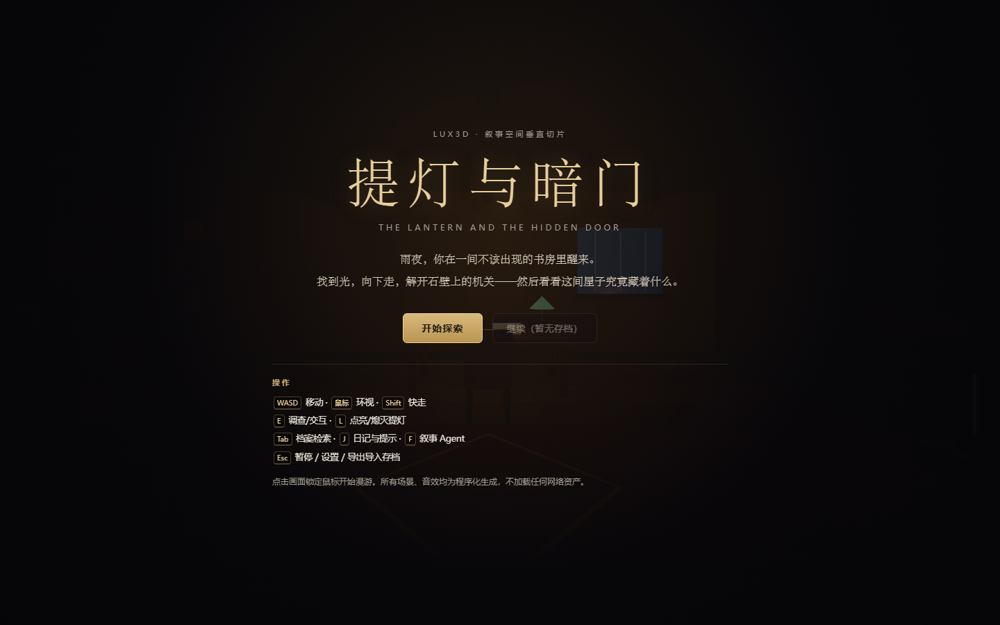

# Lux3D 叙事空间 · 提灯与暗门

> 🎮 **在线试玩：https://lux3d-lantern-demo.vercel.app**（Vercel · 17 件 Lux3D 真实资产 + SpatialGen 记忆回廊；大陆网络如打不开见 README 末尾「部署说明」）

> 一个可运行的 **3D 叙事空间** 垂直切片：第一人称探索 + 可调查物件 + 线索解锁密室 + 空间化知识检索 + 受控 Agent 问答。
> 设计底座 = **ECO 信息组织**（Environment 空间层 / Content 内容层 / Object 物件层） × **ZORK 探索感**（逐房间叙事 / 光照约束 / 物品谜题 / 日记提示 / 存档）。

## 这是什么

不是普通 3D 官网，也不是完整游戏。它验证一条可复用的内容生产与运行链路：

```
资料 → 编排 Agent → Lux3D MCP（单件模型）→ Blender 规范化 → gltf-transform 压缩
     → 场景摆放 + 知识数据 + 剧情数据 → R3F 运行期（状态机 / 检索导航 / 受控 Agent / 存档）
```

本仓库用 **程序化几何占位** 代替真实模型，把整条链路的「数据契约、状态系统、信息导航、Agent 工具」先跑通；后续接入 Lux3D/Blender 资产即可替换视觉层，不动玩法与数据层。

## 交付物

| 交付物 | 路径 | 说明 |
|---|---|---|
| 主设计文档 | [`docs/01-总体设计与实施方案.md`](docs/01-总体设计与实施方案.md) | 定位 / 需求矩阵 / 开发期+运行期架构 / ECO 信息模型 / Demo 情景与状态系统 / 受控 Agent / Lux3D 管线 / 后端与 pgvector / 路线图 |
| 可运行 Demo | [`demo/`](demo/) | Vite + React + TS + Three.js/R3F + Zustand，7 步主线可通关 |
| 后端服务骨架 | [`server/`](server/) | FastAPI + PostgreSQL/pgvector（mock 模式零依赖启动），知识检索 / Agent / 进度存档 API |
| Lux3D 资产管线 | [`pipeline/lux3d/`](pipeline/lux3d/) | 文生图 → Aholo Lux3D 图生 3D → gltf-transform 压缩 → GLB 归档，**已实跑接入真实资产** |
| 参赛选题与叙事 | [`docs/02-参赛选题与叙事方案.md`](docs/02-参赛选题与叙事方案.md) | 为什么做/为谁做/Lux3D 如何发挥作用/LuxReal 适配/选题文案/五维评审对策 |
| Aholo 技术栈适配 | [`docs/05-Aholo技术栈适配方案.md`](docs/05-Aholo技术栈适配方案.md) | 五能力分层适配矩阵：Lux3D / SpatialGen / Viewer / LuxReal / Reality + 优先级与接入方法 |
| ZCode 工程提示词 | [`docs/06-ZCode工程提示词.md`](docs/06-ZCode工程提示词.md) | 直接粘贴的主提示词 + 任务模板 + 文件工程规范 + 验收提示词 |
| ZCode 落地与开源参考 | [`docs/07-15天ZCode落地与开源参考.md`](docs/07-15天ZCode落地与开源参考.md) | 15 天分工（ZCode 主开发/DSH 检查）、Skill/MCP/Hook/权限落地、GitHub 开源架构参考、工具形态选择 |
| Lux3D 使用审计 | [`docs/08-Lux3D使用审计.md`](docs/08-Lux3D使用审计.md) | 8 件真实资产的任务 ID/参考图/原始-压缩对比/加载验证，比赛"必须用 Lux3D"的证据链 |
| 最终交接与 ZCode 计划 | [`docs/09-最终交接与ZCode开发计划.md`](docs/09-最终交接与ZCode开发计划.md) | 剩余开发交给 ZCode 的任务队列/提示词/验收门禁/提交物映射 |
| 双 Agent 协同 | [`docs/03-双Agent协同开发手册.md`](docs/03-双Agent协同开发手册.md) + [`collab/`](collab/) | DSH × ZCode 分工、文件即任务、任务板 CLI、启动提示词 |
| 提交清单与倒排期 | [`docs/04-提交清单与倒排期.md`](docs/04-提交清单与倒排期.md) | 赛事必交/加分项、11/3–11/19 倒排期、提交前检查清单 |
| 工作区入口契约 | [`AGENTS.md`](AGENTS.md) | 任何 Agent（DSH/ZCode）接手必读：状态、硬约束、命令 |
| 一手调研 | [`research/`](research/) | Zork 官网与开源仓库实现分析、探索感设计模式、ECO 备注 |
| 验收清单 | [`ACCEPTANCE.md`](ACCEPTANCE.md) | 用户诉求 → 证据映射与验收结论 |

## 快速开始

### Demo（浏览器 3D）

```bash
cd demo
pnpm install
pnpm dev -- --port 5180     # 打开 http://127.0.0.1:5180
```

无网络资产依赖：几何/材质/音效为程序化生成；若 `demo/public/models/` 中存在 Lux3D 生成的 GLB，则优先加载真实资产，缺失或加载失败自动回退程序化几何。



| 操作 | 按键 |
|---|---|
| 移动 / 视角 | WASD / 鼠标（点击画面锁定指针） |
| 奔跑 | Shift |
| 调查 / 使用 / 进入 | E |
| 提灯开关 | L |
| 档案检索（信息导航） | Tab |
| 日记 / 暂停 | J / Esc |

主线：**书桌读日记 → 书架暗格取提灯 → L 点亮 → 地板暗门 → 地下室 → 提灯照亮淋浴门与浮雕 → 转盘按 3-1-2 → 暗门 → 密室石台结局**。

剧情与文本：12 条日记目录、17 条知识档案、结局 329 汉字；中文排版（衬线正文 + 手稿日记 + 打字机叙事 + reduced-motion）与 +62% 文本量已完成。效果对比见 [`assets/screenshots/t016-compare.png`](assets/screenshots/t016-compare.png)。

### Aholo Lux3D 真实资产（已跑通）

`pipeline/lux3d/` 把 17 个可交互物件升级为 Aholo Lux3D 生成的真实 GLB（比赛要求「必须使用 Aholo Lux3D」）：

```
assets-manifest.json（17 物件 + 英文提示词 + 尺寸）
  → ① 文生图（multimodalToImage）→ 参考图
  → ② 图生 3D（imgTo3d，G1，PBR，GLB）
  → ③ gltf-transform 压缩（quantize + simplify 0.35 + WebP 1024）
  → ④ demo/public/models/<objectId>.glb + assetRegistry.ts
  → R3F useGLTF 优先加载，缺失/失败回退程序化几何
```

**实跑结果（已接入 Demo，8/17 件）**：

| 物件 | 原始 GLB | 压缩后 | 状态 |
|---|---|---:|---|
| `obj_study_diary`（半页日记） | 10.52 MB | **1.13 MB（-89%）** | ✅ |
| `obj_study_desk`（书桌） | 9.55 MB | **1.12 MB（-88%）** | ✅ |
| `obj_study_bookshelf`（整面书架） | 8.44 MB | **1.25 MB（-85%）** | ✅ |
| `obj_study_fireplace`（石壁炉） | 9.60 MB | **1.51 MB（-84%）** | ✅ |
| `obj_basement_mural`（石壁浮雕） | 9.70 MB | **1.12 MB（-88%）** | ✅ |
| `obj_basement_shower`（淋浴间玻璃门） | 8.68 MB | **1.06 MB（-88%）** | ✅ |
| `obj_basement_secret_door`（暗门） | 10.21 MB | **1.71 MB（-83%）** | ✅ |
| `obj_chamber_pedestal`（密室石台） | 12.88 MB | **3.22 MB（-75%）** | ✅ |

> 每件资产的任务 ID、参考图、原始/压缩对比见 [`docs/08-Lux3D使用审计.md`](docs/08-Lux3D使用审计.md)。

```powershell
cd pipeline/lux3d
$env:AHOLO_API_KEY = "你的Key"          # 只在终端环境变量里，不写入任何文件
node check-key.mjs                      # 只读鉴权检查，不消耗额度
node generate-assets.mjs --dry-run      # 查看计划
node generate-assets.mjs --only obj_study_diary   # 生成单件
node generate-assets.mjs                # 全量（断点续跑，已完成跳过）
```

> 安全：API Key 只从环境变量读取，脚本不打印、不落盘；`.gitignore` 已忽略 `runs/`、`.env*`。若 Key 曾在聊天/日志中出现，建议赛后到控制台轮换。

### 参赛与双 Agent 协同（DSH × 智谱 ZCode）

- **比赛**：群核科技 Aholo 全球 3D AI 黑客松，提交截止 **2026-11-19 19:00（北京时间）**；必交 = Demo 链接/视频 + 源码 + 报告书（详见 [`docs/04-提交清单与倒排期.md`](docs/04-提交清单与倒排期.md)）。
- **叙事/选题**：为什么做、为谁做、Lux3D 如何发挥作用、LuxReal 怎么适配、报名文案，见 [`docs/02-参赛选题与叙事方案.md`](docs/02-参赛选题与叙事方案.md)。
- **双 Agent 并行**：文件即任务。两个 Agent 都从 [`AGENTS.md`](AGENTS.md) 进入，用同一个任务板协作：

```powershell
node collab/cli.mjs list            # 看板
node collab/cli.mjs next            # 下一个可领任务
node collab/cli.mjs claim T-001 --owner zcode
node collab/cli.mjs done T-001 --summary "..." --files "..."
node collab/cli.mjs verify T-001    # 仅 DSH 验收
```

- **ZCode 启动**：用 ZCode 打开 `lux3d-space` 工作区，把 [`AGENTS.md`](AGENTS.md) 第 7 节的提示词粘贴到对话框即可（它会读入口文件 → 领任务 → 实现 → 交接）。
- **技能/工具**：Lux3D 可用官方 SkillHub `lux3d` 技能，或直接跑 `pipeline/lux3d/*.mjs`（DSH 与 ZCode 终端均可运行，同一脚本）；DSH 侧另有 `agent-reach`（调研）、`agent-experience`（工具设计）、`office`（报告）等 skill。

### 后端（默认 mock 模式，零依赖）

```bash
cd server
python -m venv .venv
# Windows: .venv\Scripts\activate    macOS/Linux: source .venv/bin/activate
pip install -r requirements.txt
# pg 模式（Windows）必须用启动器：python run.py    # 端口 25432
# mock 模式（零依赖）可直接：uvicorn app.main:app --host 127.0.0.1 --port 25432
```

健康检查 `GET /api/health`，交互文档 `/docs`。接 PostgreSQL + pgvector 见 [`server/README.md`](server/README.md)。

> 端口说明：本机 Windows 动态保留 TCP 段（5041–5763、8058–8157 等），5182/8765/5433 都曾在段内；示例统一 **API=25432 / DB=25433**（可换任意段外端口）。完整上手：[docs/handoff-runnable.md](docs/handoff-runnable.md)。

## 目录结构

```
lux3d-space/
├── AGENTS.md                # 工作区入口契约（DSH / ZCode 必读）
├── docs/                    # 设计 / 参赛 / 协同文档
│   ├── 00-索引.md
│   ├── 01-总体设计与实施方案.md
│   ├── 02-参赛选题与叙事方案.md
│   ├── 03-双Agent协同开发手册.md
│   └── 04-提交清单与倒排期.md
├── demo/                    # 可运行 3D Demo
│   ├── src/data/            # 场景 / 知识 / 剧情数据（数据驱动）
│   ├── src/game/            # 类型、状态机、动作、存档、交互、Agent
│   ├── src/scene/           # 第一人称控制器、房间、道具、灯光、GLB 加载
│   ├── src/ui/              # HUD、叙事日志、档案检索、Agent 面板、暂停/结局
│   └── tests/               # 状态机 + 资产契约单测（node:test）
├── pipeline/lux3d/          # Aholo Lux3D 资产管线（真实 API 已跑通）
├── server/                  # FastAPI + pgvector 骨架
├── collab/                  # 双 Agent 任务板（board.json + cli.mjs + 交接单）
├── research/                # 调研与证据（含 00-brief 作战简报）
└── assets/                  # 截图 / 报告 / 视频物料
```

## 设计要点（详见文档）

1. **数据驱动内容**：房间 / 出口 / 物件 / 触发条件 / 知识条目全部是数据，代码只负责解释器。Zork 开源实现已验证这条路线（其 `types.ts` 的 RoomDef / ObjectDef / GameState 直接可迁移）。
2. **状态只由玩家驱动**：`applyAction(state, action) -> {state, effects}` 纯函数，Agent 只能读状态、建议镜头/高亮，不能推进剧情，防止"对话越权通关"。
3. **检索 + 空间 ID = 导航**：知识条目携带 `objectId/cameraId`，检索命中后镜头定位 + 物件高亮，而不是只给一段文字。
4. **开发期/运行期分离**：内容生产（Agent + Lux3D + Blender + gltf-transform）与运行时（R3F + Zustand + FastAPI + pgvector）通过统一数据契约解耦，可独立替换。
5. **自由度**：每个模块在文档里都写了「替换点 / 扩展点 / 验收点」，从 Demo 到多章节平台按 M0→M3 路线演进。

## 参考与声明

- 参考产品：[Zork · The Great Underground Empire](https://zork-underground-empire.netlify.app/)（Ethan Mollick 的 Zork I 第一人称 3D 改编，独立项目）；[开源仓库](https://github.com/emollick/zork-underground-empire)（MIT）。
- 参考文章：[《GPT-6 Astra 把经典文字冒险游戏 Zork 改成可以漫游的 3D 动作冒险游戏》](https://mp.weixin.qq.com/s/lPK9t2SSz9hn5oA6v71M3w)。
- 本项目为独立研究与演示实现，与上述项目/作者无隶属关系；Demo 剧情、文案、知识条目为本项目原创设定。

## 部署说明（T-002）

- 在线地址：<https://lux3d-lantern-demo.vercel.app>（首次部署即生产环境；项目 `jin-qiao-wang/lux3d-lantern-demo`，部署 ID `dpl_lux3d-lantern-demo-fqow7tkj1`，构建 60s Ready 零告警）
- 产物：17 件 Lux3D GLB + SpatialGen 记忆回廊（全景 1.06MB / 3DGS PLY 实验层）+ 全部静态资源，Vercel 自动构建（`pnpm build` → `dist/`）
- 大陆网络注意：`*.vercel.app` 存在 DNS 污染，部分地区直连超时——手机 4G/热点或海外网络可正常访问；如需大陆稳定直链，备选方案为 Cloudflare Pages 或自定义域名（见 `collab/handoffs/T-002.md`）
