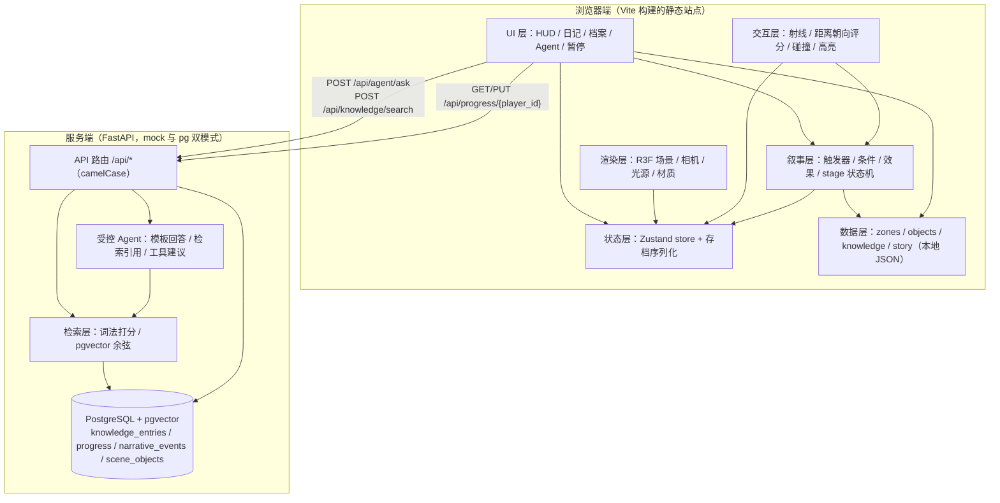
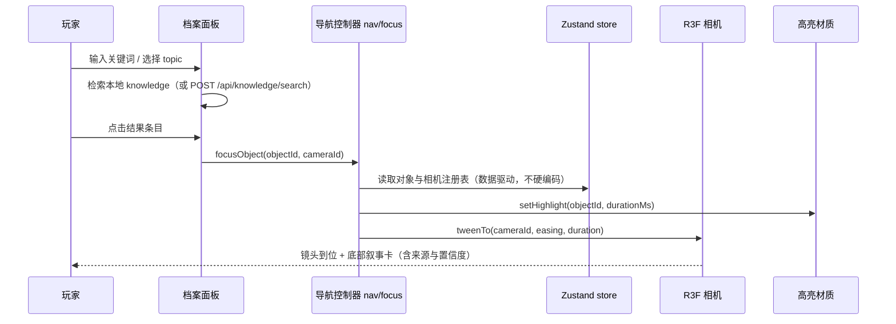
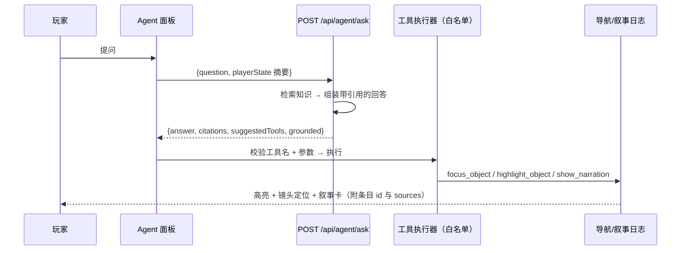
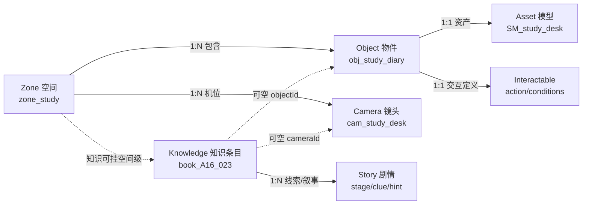
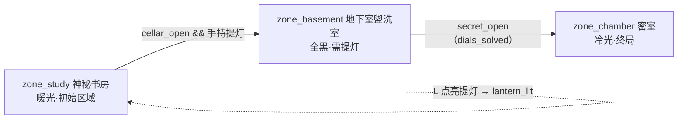
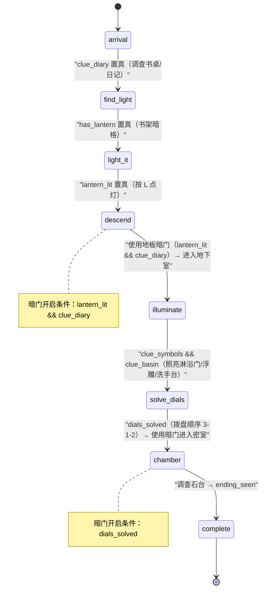
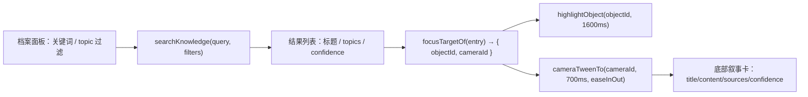
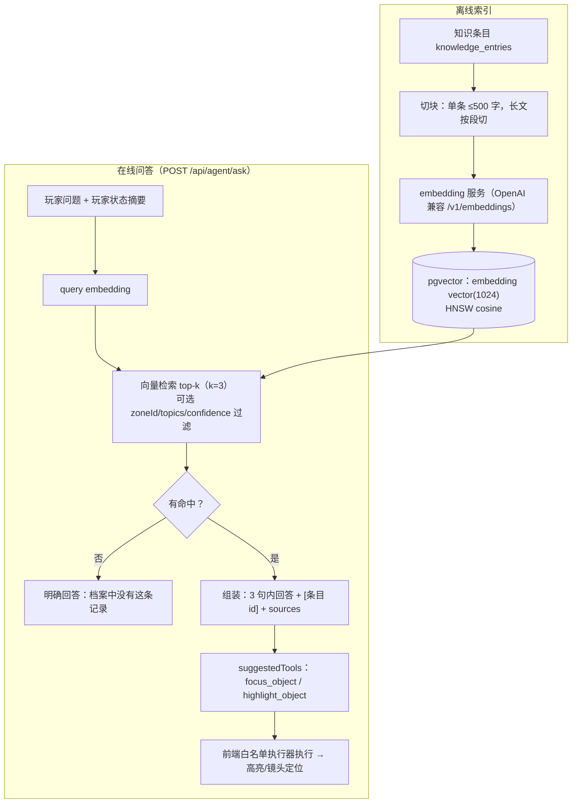

# Lux3D 叙事空间 · 总体设计与实施方案

> **项目代号**：`lux3d-space`　**首个垂直切片 Demo**：《提灯与暗门》（The Lantern and the Hidden Door）
> **文档版本**：v1.0（评审稿）　**编写日期**：2026-11-03　**作者**：doc-architect（团队 doc-architect）
> **事实来源**：`research/00-brief.md`（唯一事实来源，下称"简报"）、`research/01-zork-reference.md`、`research/02-experience-patterns.md`
> **引用约定**：`[B3.1]`=简报第 3.1 节，`[B4.3]`=简报第 4.3 节，依此类推；`[R01]`、`[R02]`=researcher 产出的两份 research 文件。所有参考事实均标注来源；凡未经验证的数字、版本或行为，均显式标注「**待验证**」或「**建议**」，不得当作已确认结论引用。

---

# 执行摘要（1 页）

**Lux3D 叙事空间是什么**：它不是"带 3D 场景的官网"，也不是"完整的 3D 游戏"。它是**以第一人称漫游为交互外壳、以空间 ID 为索引骨架、以可检索知识条目为内容底座、以受控 Agent 为辅助入口的叙事体验平台**。用户在一个房间里不是"看模型"，而是"调查—获得线索—改变状态—打开新空间"，并且随时可以检索档案、把检索结果定位回 3D 世界中的具体物件与镜头。

**一句话方案**：用 **ECO 三层信息组织**（空间 Environment / 内容 Content / 物件 Object）给每个 zone、object、camera、knowledge 条目分配稳定 ID；用 **ZORK 式探索机制**（逐房间文字描写、光照/黑暗约束、物品谜题、日记与三级提示、存档）把 ID 串成可推进的叙事线；开发期用「**编排 Agent + Lux3D Skill/MCP + Blender Python + gltf-transform**」批量产出规范化资产与内容草案，运行期用「**React Three Fiber + Zustand + 静态数据 + FastAPI/PostgreSQL/pgvector**」交付可玩体验与检索问答。

**本次交付（M0 垂直切片）**：3 个 zone（书房 / 地下室盥洗室 / 密室）、约 12 个可调查对象、7 步主线、1 个符号机关谜题（顺序 3-1-2）、提灯与黑暗、三级提示、`localStorage` 存档（导出/导入）、检索→高亮→镜头定位的档案面板、受控 Agent 本地规则 stub（接口对齐真实 LLM 工具调用），以及本文档。

**明确不做**：完整大世界、战斗、多人、真实 LLM/向量库接入（只留接口、server 骨架与文档说明）、Lux3D/Blender 实际生成资产（Demo 用程序化几何占位，文档说明替换路径）[B2.2]。

**关键决策一览**：

| # | 决策 | 结论 | 理由 |
|---|---|---|---|
| D1 | 产品形态 | 3D 叙事空间，不是 3D 官网/游戏 | 用户诉求第 2 条；核心价值在"叙事 + 探索 + 信息" |
| D2 | 前端技术栈 | React 19 + TS strict + Vite + three + R3F + drei + Zustand | 用户锁定技术栈；团队与生态成熟 |
| D3 | 数据驱动 | 房间/对象/条件/知识/剧情全部为纯数据 | 直接借鉴 ZORK `campaign.ts` 的数据驱动做法 [B3.1] |
| D4 | 状态管理 | Zustand + 纯函数 reducer `applyAction(state, action)` | 可单测、可回放、Agent 无法直接改状态 |
| D5 | 后端分工 | 内容/Agent 服务用 FastAPI；首版不引入 Node BFF | Python 侧 RAG/嵌入/pgvector 生态更顺；前端静态托管 |
| D6 | 检索索引 | pgvector（HNSW）+ 关键词/主题过滤的混合检索 | 满足"检索 + 空间 ID → 3D 导航"的核心诉求 [B1.6] |
| D7 | Agent 边界 | 只读状态 + 只调用前端白名单工具，禁止推进剧情 | 用户诉求"受控 Agent"；简报 4.9 硬性约束 |
| D8 | 资产管线 | Blender 规范化（1 单位=1m、原点底部中心、Y-up/-Z 前向）→ gltf-transform 压缩 | 统一管线是可扩展性与性能的前提 |
| D9 | 探索感机制 | 逐房间文案、黑暗约束、物品谜题、日记、三级提示、存档 | 一手源码验证的 ZORK 探索感六件套 [B3.1] |
| D10 | 可扩展性 | 三层替换点：数据 / 模块 / 管线；每章给出替换点与验收点 | 用户诉求"模块可替换、数据驱动、内容可加量" [B1.12] |

**关键数字**：文档目标 ≥18000 汉字（本版实测约 2.5 万汉字）；Demo 3 个 zone、12 个交互对象、8 条知识条目、7 步主线、3 级提示；知识库 4 张核心表、8 个对外 API、7 个 Agent 前端工具；运行期性能预算：整场景 Draw call ≤150、三角面 ≤250k、纹理显存 ≤64MB、初始包体 ≤8MB（gzip）、1080p 中端 GPU ≥60fps（Demo 程序化几何实际远低于预算）。

**风险前三**：①R3F/React 19 依赖组合安装失败（预案：降级 React 18 + R3F 8 + drei 9 [B2.3]）；②程序化占位几何观感不足以验证"叙事空间"体验（预案：先验证机制闭环，资产由 M1 管线替换）；③Agent 幻觉与越权（预案：白名单工具 + 只读状态 + 无依据回答"档案中没有记录"）[B4.9]。

**下一步**：M0 验收后进入 M1（内容管线）→ M2（RAG/Agent）→ M3（多章节平台），详见第 13 章。

---

# 第 1 章 文档说明、术语表与阅读路径

## 1.1 文档目的与范围

本文档是 `lux3d-space` 项目的**单一主设计文档**（single source of truth for design），同时承担三个角色：

1. **方案说明书**：把用户 14 条诉求 [B1] 转成可执行的需求矩阵、架构、数据模型与接口。
2. **实施手册**：给出可直接落地的 ID 规范、JSON Schema、状态机、工具 JSON Schema、Blender 规范、gltf-transform 命令、PostgreSQL DDL 与 API 清单。
3. **验收基准**：每个模块结尾以「替换点 / 扩展点 / 验收点」三小节收口，验收点写成可检查的条目。

**在范围内**：项目定位与自由度设计、需求矩阵、开发期与运行期架构、技术选型、内容与信息模型、Demo《提灯与暗门》完整设计、叙事系统、3D 交互与信息导航、受控 Agent、Lux3D 资产管线、后端与数据库、实施路线与风险、附录（JSON/代码/命令/参考链接）。

**不在范围内**：完整大世界的内容生产、战斗与多人系统、真实 LLM/向量库的生产接入、Lux3D/Blender 实际生成的资产文件 [B2.2]。这些内容以"接口 + 骨架 + 替换路径"的方式在文中说明，不假装已完成。

**文档与代码的关系**：本文档先于代码完成，Demo 代码（`demo/`）按本文档第 7、8 章实现；若实现存在偏差，以「代码可运行 + 文档记录偏差」为准，并在下一版文档中回填。第 7.9 节给出文档条目与代码文件的映射基线。

## 1.2 给不同读者的阅读路径

不同角色目标不同，以下是建议的**最短阅读路径**（按需跳读，全文不要求顺序读完）：

| 读者 | 目标 | 必读章节 | 选读章节 | 预计用时 |
|---|---|---|---|---|
| 决策者 / 产品负责人 | 判断做什么、不做什么、代价多大 | 执行摘要 → 第 2 章 → 第 3 章 → 第 13 章 | 第 5、12 章 | 20 分钟 |
| 前端 / 3D 工程师 | 知道要写哪些文件、状态如何流转 | 第 4.1/4.2 节 → 第 6 章 → 第 7 章 → 第 8 章 → 第 9 章 → 第 14 章附录 | 第 5 章 | 50 分钟 |
| 内容 / 研究 / 世界观 | 知道资料如何变成知识条目与剧情数据 | 第 2.3 节 → 第 6 章 → 第 7.3/7.5 节 → 第 10 章 → 第 11 章 | 第 14.1 节 | 40 分钟 |
| 后端 / 数据工程师 | 知道表结构、API、检索与存档同步 | 第 4.2 节 → 第 8.3/8.4 节 → 第 10.3 节 → 第 12 章 | 第 11 章 | 40 分钟 |
| 资产 / TA（技术美术） | 知道建模规范、导出与验收 | 第 11 章 → 第 14.2/14.3 节 | 第 5.4 节 | 25 分钟 |
| 测评 / 验收人员 | 知道怎么判定"做完了" | 第 3.4 节 → 各章「验收点」→ 第 7.8 节 → 第 13 章 | 第 14 章 | 30 分钟 |

## 1.3 术语中英对照表

本项目同时涉及 3D、游戏叙事、知识检索与 Agent 四个领域，术语容易混用。下表为全文统一口径（出现歧义时以此表为准）。

| 中文 | English | 本文含义 |
|---|---|---|
| 3D 叙事空间 | 3D Narrative Space | 本项目产品形态：第一人称漫游 + 环境叙事 + 可调查对象 + 状态推进 |
| 垂直切片 | Vertical Slice | 只做一小段但做出完整体验闭环的 Demo（本项目的 M0） |
| 生态信息组织（工作定义） | ECO (Working Definition) | 本文采用的三层工作定义：**E**nvironment 空间层 / **C**ontent 内容层 / **O**bject 物件层；该缩写无公认权威定义（待验证） |
| 空间 ID | Spatial ID | 指向 zone / object / camera / knowledge 的稳定字符串标识，是"检索结果回到 3D"的连接键 |
| 区域 | Zone | 一个可进入的空间单元，如 `zone_study`；含光照、进入条件、对象集合 |
| 镜头定位点 | Camera / Viewpoint | 预置相机位姿，`cam_<zone>_<slug>`；用于检索结果的"镜头定位" |
| 交互对象 | Interactable Object | 可被射线选中并调查/使用的实体，`obj_<zone>_<slug>` |
| 线索 | Clue | 调查对象后写入 flags/journal 的信息，用于解锁后续条件 |
| 旗标 | Flag | 布尔状态位（如 `lantern_lit`、`dials_solved`），是条件系统的原子单位 |
| 阶段 / 章节阶段 | Stage | 主线推进的离散状态（本 Demo 8 个：arrival…complete） |
| 触发点 | Trigger | "何时检查条件"的事件（进入区域、交互、Flag 变化、定时） |
| 条件表达式 | Condition DSL | 描述"是否允许"的声明式表达式（all/any/not + flag/item/stage/zone） |
| 效果 | Effect | 动作产生的结果（setFlag / addItem / setStage / playSound / unlock / journal） |
| 叙事日志 | Narration Log | 屏幕底部的滚动文字，ZORK 式环境描写与反馈 |
| 日记 | Journal | 自动记录已获线索与提示的文字列表，对应 J 键 |
| 三级提示 | 3-level Hint | 提示由弱到强三级，逐级消耗 `hintsUsed`，不惩罚玩家 |
| 存档 | Save | 进度序列化 JSON（`lux3d.save.v1`），支持导出/导入与版本迁移 |
| 知识条目 | Knowledge Entry | 可检索的内容单元（含 id/zone/object/camera/title/topics/content/sources/confidence） |
| 置信度 | Confidence | 知识可信级别：`verified` / `inferred` / `uncertain` |
| 检索增强生成 | RAG (Retrieval-Augmented Generation) | 先检索知识块再让模型组织回答，回答必须引用条目 id |
| 受控 Agent | Constrained Agent | 只读游戏状态、只调用白名单前端工具的运行时助手 |
| 编排 Agent | Orchestration Agent | 开发期 Agent：检索资料、整理证据、产出资产清单与内容草案 |
| 前端工具 | Client Tool | 暴露给 Agent 的前端函数（如 `focus_object`），有 JSON Schema 与权限白名单 |
| 空间导航 | Spatial Navigation | 检索结果 → 高亮对象 → 镜头定位 → 叙事卡的信息—空间映射链路 |
| 资产管线 | Asset Pipeline | 资料→模型→规范化→压缩→场景摆放的全过程 |
| 规范化模型 | Normalized Model | 满足单位/原点/朝向/命名/材质/碰撞规范的 GLB 模型 |
| 碰撞体 | Collider | 用于物理或射线判定的简化几何，命名 `UCX_*` |
| 绘制调用 | Draw Call | 一帧内提交的渲染批次；性能预算核心指标 |
| 首屏可交互时间 | TTI (Time To Interactive) | 页面可被玩家操作的时间点 |
| 纯函数 reducer | Pure Reducer | 无副作用的 `(state, action) => {state, effects}` 函数，可单测与回放 |

> **关于 ECO 的说明**：写作时未检索到 ECO 信息组织的公认权威定义（简报 6.3 要求"若无可明确定义，写本文采用的工作定义"）。因此本文把 ECO 定义为**空间（Environment）—内容（Content）—物件（Object）三层信息组织法**，并用"ID 链"实现层间可追溯。该定义是**可替换的架构约定**，不是学术结论；若后续获得更权威的 ECO 定义，只需替换第 6.1 节的定义与 ID 映射，不影响其他章节的机制。

## 1.4 引用、标注与约定

- **引用**：参考事实只来自简报第 3 节与 `research/` 文件。引用 ZORK 项目事实时标注 `[B3.1]`（Zork 官网一手证据）、`[B3.2]`（微信技术拆解文）、`[B3.3]`（仓库证据）、`[R01]/[R02]`（researcher 深挖结果）。
- **待验证（TBC）**：涉及具体版本号、第三方能力、未实测性能时标注「待验证」；不臆造 Zork 项目的细节、版本或数据。
- **建议（Recommendation）**：尚未决策或存在多种合理方案时标注「建议」，并给出选择依据与替代项。
- **数字口径**：性能预算、内容规模、工期均为**规划值/建议值**，以实测为准；引用 ZORK 的数字（约 30 个区域、19 件宝物等）来自 [B3.1]，属参考事实而非本项目指标。
- **代码块语言**：`ts` 为 TypeScript 片段（可能是示意而非最终实现）；`json` 为数据示例；`sql` 为可直接执行的 DDL 草案；`bash` 为命令。

## 1.5 文档维护规则

本文档是活文档（living document）。维护规则如下：

1. **版本**：`v<主>.<次>`，主版本随架构/数据模型不兼容变更递增；当前 v1.0。
2. **事实回填**：researcher 产出 `research/01`、`research/02` 后，回填交叉引用与实证细节（本版已预留 `[R01]/[R02]` 挂点）。
3. **偏差记录**：代码与文档不一致时，在对应章节加「实现偏差」条目，注明文件与原因，禁止静默改文档。
4. **变更影响**：修改 ID 规范（第 6.2 节）、flags/stage（第 7、8 章）、知识 schema（第 6.3 节）属于破坏性变更，需同步更新第 14 章附录示例与 Demo 数据文件。

### 替换点 / 扩展点 / 验收点（第 1 章）

- **替换点**：`research/00-brief.md` 是事实来源，但可被"项目章程 + 第 3 节参考事实库"替代；文档本身可拆分为多文件（建议 M3 时按章拆分并保留索引）。
- **扩展点**：术语表可按领域扩表（资产/后端/合规）；阅读路径可按新角色（运营、法律、本地化）增加行。
- **验收点**：术语表覆盖第 2–14 章出现的全部专有名词（抽查 10 个必须命中）；每章一级标题与简报第 5 节 14 项一一对应（见第 13.4 节自检表）；全文无未标注来源的参考事实。

---

# 第 2 章 项目定位：什么是 3D 叙事空间

## 2.1 定义与五个判定特征

**定义**：3D 叙事空间（3D Narrative Space）是一种以**第一人称空间漫游**为交互外壳、以**环境叙事**为信息载体、以**状态推进**为叙事动力的数字体验形态。玩家不是点击菜单看内容，而是在空间里走动、观察、调查，通过自己的动作改变世界状态，从而触发新叙事。

一个产品满足以下**五个特征**才算项目语境下的"3D 叙事空间"（缺一即退化为别的形态）：

| # | 特征 | 判定问题 | 本项目落点 |
|---|---|---|---|
| F1 | **第一人称在场** | 玩家是否有"身体在空间里"的连续视角（而非固定机位/轨道相机）？ | 鼠标 + WASD 第一人称，Pointer Lock，碰撞与高度固定 |
| F2 | **环境叙事** | 信息是否通过空间与物件本身传达（而非只靠文本/视频）？ | 日记、浮雕、淋浴玻璃门后轮廓、油画、镜子 |
| F3 | **可调查对象** | 是否存在可选中、有反馈、有状态的对象集合？ | 约 12 个 `obj_*`，每个有 action 与条件 |
| F4 | **状态推进与解锁** | 玩家行为是否改变世界状态并解锁新空间/新内容？ | 7 步主线、8 个阶段、`cellar_open`/`secret_open` 两道门 |
| F5 | **信息与空间互链** | 内容能否定位回空间（检索→高亮→镜头），空间能否定位回内容？ | 知识条目含 `zoneId/objectId/cameraId`，档案面板双向映射 |

**反例**（不满足 F3/F4/F5，不属于本项目形态）：产品官网的 3D 旋转模型页、VR 看房、固定路线的 3D 视频导览、带 3D 封面的图文长页。

## 2.2 与相邻形态的区别

| 形态 | 目标 | 交互 | 内容组织 | 状态 | 本项目差异 |
|---|---|---|---|---|---|
| 普通 3D 网站 / 产品页 | 展示与转化 | 转模型、点热点 | 页面层级 | 几乎无 | 我们要求状态推进与叙事动力，内容可检索 |
| 商业 3D 游戏 | 娱乐与挑战 | 战斗/解谜/成长 | 任务与关卡 | 复杂 | 我们不追求战斗与长线成长，强调"信息可被理解与检索" |
| 数字展馆 / 虚拟展厅 | 陈列与导览 | 漫游 + 点击展品 | 展厅分区 | 弱 | 我们有条件锁、线索链与 Agent 检索，且有严格空间 ID 体系 |
| 电子书 / 互动小说 | 阅读与选择 | 文字选择 | 章节 | 分支状态 | 我们有真实 3D 空间与空间定位，不只是文字分支 |
| 教育 VR 场景 | 训练 | 操作流程 | 课程模块 | 步骤检查 | 我们更强调"探索感"与内容自由度，而非固定流程考核 |

**结论**：Lux3D 的差异化护城河不是"3D 画质"，而是 **"内容—空间—状态"三者的强耦合**：每条内容都能落到 3D 位置，每个空间动作都改变叙事状态，每个状态都能被 Agent 与检索系统理解。这也是为什么本项目的核心工作不是建模，而是**信息模型 + 状态机 + ID 规范**。

## 2.3 ECO 信息组织 × ZORK 探索感的融合

### 2.3.1 两者各解决什么问题

- **ECO 解决"信息如何被找到"**：把内容挂在稳定的空间锚点上（zone → object → camera → knowledge），使检索结果可以"回到 3D"，而不是一堆无法定位的文本。
- **ZORK 解决"信息如何被渴望"**：用黑暗、门锁、线索、日记、提示把信息变成玩家主动探索的奖励，而不是被动阅读的说明。

用一句话概括融合公式：

> **ECO 提供"可寻址的世界"，ZORK 提供"值得探索的动机"；前者是数据结构，后者是节奏设计。**

### 2.3.2 ZORK 探索感六件套 → 本项目的映射

基于 ZORK 官网与仓库的一手证据 [B3.1]，其探索感 = 第一人称移动 + 逐房间文字描述 + 光照/黑暗约束 + 物品谜题 + 日记/提示 + 存档。逐项映射到本项目（并标注 ECO 层次）：

| ZORK 机制 | 证据 | 本项目落点 | ECO 层 | 实现章节 |
|---|---|---|---|---|
| 第一人称移动 + 逐房间文字描述 | `RoomDef.description`、`campaign.ts` 纯数据房间 [B3.1] | 进入 zone / 调查对象时底部叙事日志输出描写；zone 有 `enterText` | E | 7.2、8.2 |
| 光照 / 黑暗约束（Grue 机制） | `darkness.ts` 的 `carriesLight()` / `hasLight()` / `grueTiming()` [B3.1] | 提灯点亮前后的能见度差异；地下室无灯则黑屏提示并强制返回 | E + O | 7.4、8.5 |
| 物品谜题 | `ObjectDef.action/requires/hiddenIf` [B3.1] | 日记→书架→提灯链；符号 3-1-2 谜题 | O | 7.3、7.5 |
| 日记自动记录 | `journal` 状态 + J 键 [B3.1] | `journal[]` 记录线索与提示；不写死文本 | C | 7.7、8.2 |
| 三级提示 | ZORK 日记内三级提示 [B3.1] | `request_hint(level 1/2/3)`，不惩罚、计入 `hintsUsed` | C | 7.6、10.4 |
| 存档导出/导入 | ZORK 存档导出/导入、多难度 [B3.1] | `lux3d.save.v1` + JSON 导出/导入 + 坏档回退 | C | 8.3、12.4 |
| 数据驱动房间/对象/条件 | `types.ts` 的 `RoomDef/ExitDef/ObjectDef` [B3.1] | 本项目的 `zone/object/story` JSON 与条件 DSL | E+O | 6.4、6.5 |
| 朝向+孔径+距离的门口判定 | `interaction-target.ts` 评分函数 [B3.1] | 交互判定采用同类评分：朝向 × 距离 × 目标孔径，背对不提示 | O | 9.3 |
| 地图 / 指南针 / 触控 | ZORK HUD 地图 M、触控 [B3.1] | 首版仅 compass 式方向提示；地图与移动端列为二期 | E | 9.6、13.2 |

### 2.3.3 融合的三条设计原则

1. **空间即索引**：任何内容都要回答"它在哪"（zoneId/objectId/cameraId），无空间锚点的内容只能进"世界观附录"，不能进检索主库。
2. **状态即叙事**：能用状态变化表达的信息，不用静态文本表达。例："暗门开"不是一段文字，而是 `dials_solved=true → 门动画 + 新空间可进入"。
3. **探索有代价但无惩罚**：错误拨盘只震动可重试，提示只记录不扣分，与简报"错误选择不丢物品，可重来"[B4.6] 保持一致。

### 2.3.4 参考路径的可迁移性结论

微信技术拆解文的事实说明了这条路线可行：Mollick 用 GPT-6 Astra 把 Zork 改编为完整 3D 游戏，**保留原版剧情/谜题/文案**，角色与环境**全部在 Three.js 中程序化构建**，人类只给初始指令与少量 nudge，且成品**完整可玩、有测试覆盖** [B3.2]。由此得到两条直接指导本项目的结论：

1. **"优质现成叙事底座 + AI 生成实现"是可行路径**：本项目必须先有"内容底座"（ECO 知识条目 + 剧本数据），再谈生成实现 [B3.2]。
2. **分层生成、避免一次生成整世界**：内容层（人工/编排 Agent 整理）与实现层（Lux3D/Blender/代码生成）分离；Demon 只做一个房间与一条线索，正是"垂直切片"的纪律。

## 2.4 自由度与可扩展性总原则

用户要求"模块可替换、数据驱动、内容可加量"[B1.12]。本项目把自由度拆成**三层可替换边界 + 五类扩展场景**，并用「替换点 / 扩展点 / 验收点」在每章收口。

### 2.4.1 三层可替换边界

| 层 | 可替换对象 | 替换成本 | 替换方式 | 不变量（必须保持） |
|---|---|---|---|---|
| 数据层 | 知识条目、剧情、对象表、提示文案 | 低（改 JSON，不动代码） | 替换 `data/*.json` 或数据库内容 | ID 规范、schema 校验、引用完整性 |
| 模块层 | 渲染器、状态库、检索服务、Agent 运行时 | 中（改适配层） | 通过接口/适配器替换实现 | `applyAction` 语义、工具 JSON Schema、API 契约 |
| 管线层 | Lux3D 生成器、Blender 脚本、压缩工具、后端框架 | 中高（换工具链） | 保持目录与验收标准的"管线契约" | 规范化模型规范、`UCX_` 命名、glTF 输出 |

### 2.4.2 五类扩展场景（数据驱动验证）

| 扩展需求 | 是否改代码 | 操作 | 验收信号 |
|---|---|---|---|
| 加一个 zone | 否（Demo 阶段）/ 少量（需要新几何） | 加 zone 数据 + 相机 + 对象 + 知识条目 | 新 zone 可进入、可检索、可镜头定位 |
| 加一个章节 | 否 | 复制剧情数据模板，改 ID 前缀 | 章节切换不破坏存档（版本迁移） |
| 加一种语言 | 否 | 文案字段拆 i18n key（扩展点） | 中文/英文切换后检索仍命中 |
| 换 3D 引擎 | 是（渲染层） | 保留数据与后端，重写渲染适配层 | 数据零改动；交互评分逻辑可复用 |
| 换 LLM / 换向量库 | 是（Agent/检索层） | 保留工具 Schema 与 API 契约，替换 provider | 工具调用行为与评测指标不退化 |

### 2.4.3 可扩展性的成本纪律

- **内容加量 ≠ 代码加量**：新增内容只允许改数据；若改代码，说明信息模型缺失，应回到第 6 章补 schema。
- **一次只扩展一个维度**：M1 扩"资产"、M2 扩"Agent"、M3 扩"多章节"，不同时扩。
- **每个扩展必须带验收**：否则不进入主线版本。

### 替换点 / 扩展点 / 验收点（第 2 章）

- **替换点**：ECO 工作定义可被更权威的定义替换（只影响第 6.1 节与 ID 映射）；"ZORK 式"可替换为其他探索范式（如 Metroidvania 能力锁），只要保持 F1–F5 五特征与六件套中的至少四件。
- **扩展点**：探索感六件套可按章节增补（如加入"声音线索""天气系统"）；自由度三层可向下细化为"每模块的适配器接口"。
- **验收点**：①五特征判定表中 F1–F5 在 Demo 中均可演示；②ZORK 六件套映射不少于 6 行且均指向具体章节与对象 ID；③五类扩展场景各给出一条可执行操作，且至少"加 zone/加章节/加语言"在 Demo 数据上可做纸面推演；④引用 ZORK 事实均带 `[B3.1]/[B3.2]` 标注。

---

# 第 3 章 需求拆解与需求矩阵

## 3.1 用户 14 条诉求 → 可执行需求矩阵

简报第 1 节逐条保留用户原始诉求 [B1]。下表把它们转成带编号、优先级、验收标准、责任章节的**需求矩阵**（R-01…R-14 与用户 14 条一一对应，不增不减；派生需求见 3.2 节）。

| 编号 | 用户诉求（摘要 / 来源句） | 需求描述 | 优先级 | 落地设计 | 验收标准 | 章节 |
|---|---|---|---|---|---|---|
| R-01 | 技术栈锁定 TypeScript + Three.js/R3F + Zustand + Blender Python + gltf-transform + Node/FastAPI + PostgreSQL/pgvector [B1.1] | 全项目在上述技术栈内实现，不引入栈外核心依赖 | P0 | 第 5 章选型表；`demo/package.json`；`server/` | Demo `pnpm build` 通过；依赖清单可审计；无未说明的栈外核心依赖 | 5、7、11、12 |
| R-02 | 产品类型：3D 叙事空间，非普通 3D 官网 [B1.2] | 满足 F1–F5 五特征：第一人称、环境叙事、可调查、状态推进、信息空间互链 | P0 | 第 2.1 节判定表；第 7 章 Demo | 五特征逐项可演示（人工走查清单） | 2、7 |
| R-03 | 先做小 Demo：神秘书房、可调查物品、一条线索解锁密室；体现 ECO × ZORK [B1.3] | 3 zone / ~12 对象 / 1 条线索链 / 程序化几何 | P0 | 第 7 章；第 4.1 节管线 | 完整通关路径存在且可重复；ECO 映射表与 ZORK 六件套均落地 | 7 |
| R-04 | Demo 流程：取得提灯→地下室→照亮淋浴门→打开暗门→密室 [B1.4] | 7 步主线、两道具、三道门条件 | P0 | 第 7.4/7.5 节条件表 | 主线 7 步顺序推进测试通过；越序被拒绝 | 7、8 |
| R-05 | 需要情景图与状态系统、状态解锁机制 [B1.5] | mermaid 情景图 + Zustand store + 纯函数状态机 + 解锁条件 | P0 | 第 7.2/7.5 节；第 8 章 | 状态机单测通过（推进/拒绝/存档往返） | 7、8 |
| R-06 | Agent 定位：检索 + 空间 ID → 3D 导航 [B1.6] | 受控 Agent 回答引用知识条目，并可调用 `focus_object` 等工具驱动 3D 导航 | P0 | 第 10 章；第 9.5 节 | Agent 回答含 `[条目 id]` 与 sources；工具调用可定位镜头/高亮 | 9、10 |
| R-07 | 开发期/生产期管线（资料→编排 Agent→Lux3D→Blender→压缩→摆放→运行时）[B1.7] | 管线图 + 每阶段输入输出 + 目录规范 + 验收清单 | P0 | 第 4.1 节；第 11 章 | 管线图元素齐全；每阶段有验收点；命令可执行（示意） | 4、11 |
| R-08 | 运行期分层（Three.js/R3F 场景、信息导航、叙事系统、受控 Agent）[B1.8] | 运行期四层模块边界清晰、依赖单向 | P0 | 第 4.2 节边界表；第 9 章 | 模块边界表完整；无循环依赖设计 | 4、9 |
| R-09 | 知识条目 schema（用户原型 JSON）[B1.9] | 保留用户原型字段并扩展 `relatedObjectIds/spoilerLevel`，含校验规则与生成流程 | P0 | 第 6.3 节 | 8 条知识条目通过 JSON Schema 校验；含样例条目 `book_A16_023` | 6、7 |
| R-10 | 数据流闭环（Lux3D→Blender→gltf-transform→Three.js→Zustand→后端检索/存档）[B1.10] | 资产流/知识流/剧情流/进度流四条数据流定义清晰 | P0 | 第 4.4 节 | 四条数据流各给输入/载体/消费者；单向依赖 | 4 |
| R-11 | "适配总体的、添加 Agent"：Agent 是体系一部分 [B1.11] | 开发期编排 Agent 与运行期受控 Agent 双 Agent 设计 | P0 | 第 10 章；第 11.2 节 | 两类 Agent 各有职责边界、工具、权限、评测 | 10、11 |
| R-12 | 自由度/可扩展性：模块可替换、数据驱动、内容可加量 [B1.12] | 每章「替换点/扩展点/验收点」；三层替换边界；五类扩展场景 | P0 | 第 2.4 节；各章结尾 | 抽查 3 章均有三小节；扩展场景纸面可执行 | 全篇 |
| R-13 | 参考链接：在线 Demo、微信技术拆解文 [B1.13] | 引用并核验参考来源，不编造细节 | P1 | 第 14.6 节；第 2.3.4 节 | 附录含全部三条链接；事实标注来源 | 2、14 |
| R-14 | 整理成一份完整文档并在框架内实行 [B1.14] | 单一中文文档 + 可运行 Demo + server 骨架 + 验收清单 | P0 | 本文档；`demo/`；`server/`；`docs/验收清单.md` | 文档 ≥18000 汉字、14 章覆盖；Demo 满足简报 4.11 | 全篇 |

## 3.2 派生需求（非功能与工程约束）

用户诉求之外，工程上必须满足的派生需求（N = Non-functional）：

| 编号 | 需求 | 指标/判据 | 优先级 | 落地 | 验收 |
|---|---|---|---|---|---|
| N-01 | 性能 | 整场景 Draw call ≤150、三角面 ≤250k、纹理显存 ≤64MB、交互后 1 帧内反馈、1080p ≥60fps（建议值） | P0 | 第 11.7 节性能预算 | Demo 本地实测帧率与 draw call（渲染器 info） |
| N-02 | 可维护/数据驱动 | 新增内容不改代码；schema 校验进 CI | P0 | 第 6 章 schema | 校验脚本对样例数据全绿 |
| N-03 | 安全与权限 | Agent 只读、工具白名单、参数校验、无 API key 泄漏前端 | P0 | 第 10.5 节 | 越权用例（改 flag/传非法 objectId）被拒 |
| N-04 | 可访问性 | 文字可读、色弱可辨、支持键鼠完整操作、叙事文字可复制 | P1 | 第 9.6 节 | 走查清单；Demo 键盘可全程通关 |
| N-05 | 可测试性 | 状态机纯函数可单测；至少 7 步主线 + 拒绝 + 存档往返 | P0 | 第 8.5 节 | `node --experimental-strip-types --test tests/*.test.ts` 通过 |
| N-06 | 兼容与降级 | 依赖安装失败可降级 React 18 + R3F 8 + drei 9 [B2.3]；无 LLM key 时规则引擎降级 [B4.9] | P1 | 第 5.5 节；第 10.8 节 | 降级路径文档化；无 key 可完成问答 |
| N-07 | 可观测性 | 埋点事件、错误上报（可选）、检索命中统计 | P2 | 第 12.6 节 | 事件表存在；Demo 至少本地 console 日志 |

## 3.3 需求优先级与里程碑映射

| 里程碑 | 覆盖需求 | 交付物 | 判定"完成"的硬指标 |
|---|---|---|---|
| **M0（本次）** | R-01/02/03/04/05/06/07（文档部分）/08/09/10/11（运行期 stub）/12/13/14 | 本文档 + `demo/` 可运行 + `server/` 骨架 + 验收清单 | 简报 4.11 全部通过；文档 14 章齐备且 ≥18000 汉字 |
| **M1 内容管线** | R-07 完整化、R-11 编排 Agent 落地、N-01/N-02 | Blender 规范化脚本、gltf-transform 脚本、Lux3D 接口、资产清单与验收报告 | 一条真实资产从资料到 GLB 入场景；体积与 draw call 达标 |
| **M2 Agent/RAG** | R-06 完整化、N-03/N-06 | FastAPI 检索与 Agent 服务、pgvector 索引、评测报告 | 检索命中率与引用准确率达阈值（建议 ≥85% 引用可回溯） |
| **M3 多章节平台** | R-12 完整化、N-04/N-07 | 章节打包规范、内容管理流程、埋点与运营看板 | 新增一章不改代码；内容可回滚 |

## 3.4 非目标（明确不做，避免范围蔓延）

| 非目标 | 理由 | 何时重启 |
|---|---|---|
| 完整大世界 / 开放世界 | 垂直切片优先验证机制闭环 [B2.2] | M3 之后 |
| 战斗、多人 | 与"叙事 + 信息"定位无关 | 明确产品方向变化后 |
| 真实 LLM/向量库生产接入 | M0 无 key、无数据量；先接口对齐 | M2 |
| Lux3D/Blender 实际生成资产 | Demo 用程序化几何占位 [B2.2] | M1 |
| 移动端完整支持 | 时间预算；布局不崩即可 [B4.10] | 二期 |
| 商业支付/账号体系 | 首版用匿名玩家令牌 | M3 |

## 3.5 需求验收基线（Demo 硬性）

Demo 验收直接采用简报 4.11 的 5 条硬性标准 [B4.11]：

1. `node <pnpm> install` 成功，`node <pnpm> build` 成功（tsc 无错）。
2. `node --experimental-strip-types --test tests/*.test.ts` 通过：至少覆盖 7 步主线推进、错误条件不推进、暗门/结局条件、存档序列化往返。
3. `node <pnpm> dev --port 5180` 起服务后 `curl http://127.0.0.1:5180/` 返回 200 且 HTML 含 root 挂载点；`dist/` 可 `preview`。
4. 代码无 TODO 占位导致主流程中断；无 `console.error` 启动报错。
5. `demo/README.md` 说明运行方式、操作、文件结构、与文档对应关系。

### 替换点 / 扩展点 / 验收点（第 3 章）

- **替换点**：需求矩阵的"验收标准"列可直接转成 `docs/验收清单.md` 的检查项；优先级体系（P0/P1/P2）可替换为 MoSCoW 或 RICE，不影响需求条目本身。
- **扩展点**：新增需求按 `R-15…` 递增，非功能按 `N-08…` 递增；可加"需求 → 测试用例"映射列，形成需求可追溯矩阵（RTM）。
- **验收点**：①R-01–R-14 与用户 14 条一一对应、无遗漏（自查：14 行）；②每条 R 有优先级/落地/验收/章节四要素；③非目标表至少 6 行且给出重启条件；④需求矩阵与简报 4.11 验收基线一致。

---

# 第 4 章 总体架构

## 4.1 开发期管线（Authoring Pipeline）

开发期负责"把资料变成可运行的世界"。管线严格按用户给定的顺序 [B1.7] 执行，每个阶段有明确输入、输出与验收，**不允许跳阶段**（跳阶段会导致坐标/命名/体积债务回流）。


| 阶段 | 输入 | 处理 | 输出 | 工具 | 验收点 |
|---|---|---|---|---|---|
| P0 资料收集 | 图片/视频/网页/文字设定 | 编排 Agent 检索、去重、标注来源 | `research/` 证据卡与引用清单 | 编排 Agent + 人工复核 | 每条资料有来源 URL/出处与置信度 |
| P1 内容规划 | 证据卡 | 产出资产清单（zone/object/asset 三列）与内容草案 | `assets-manifest.json`、知识条目草案 | 编排 Agent（见 10.2） | 清单经人工审核；ID 符合第 6.2 节 |
| P2 单件生成 | 资产清单条目 | 调用 Lux3D Skill/MCP 生成单件模型（占位或成品） | `raw_glb/*.glb` | Lux3D Skill/MCP | 单件模型可被 Blender 打开且无空对象 |
| P3 规范化 | 原始模型 | Blender Python 统一单位/原点/朝向/命名/材质/碰撞体 | `normalized/*.blend` 与 `*.glb` | Blender + `tools/blender/normalize.py` | 通过 11.6 节验收清单 |
| P4 压缩 | 规范化 GLB | 去重、量化、Draco/Meshopt、纹理压缩 | `public/assets/models/*.glb` | gltf-transform | 体积、Draw call、贴图尺寸达标（11.7） |
| P5 场景摆放 | 压缩后模型 + 空间设计 | 摆放、相机位、交互锚点、光源 | `zones.json`（含 transform/cameraId） | 编辑器脚本 + 手工校验 | 每个 object 都有 transform 与交互点 |
| P6 数据挂接 | 摆放结果 | 知识条目/剧情/提示与 ID 关联 | `knowledge.json`、`story.json` | 内容工具 + schema 校验 | 引用完整性校验全绿（6.6） |
| P7 构建交付 | 全部数据 | 静态构建、资源校验、冒烟测试 | `dist/` | Vite + CI 脚本 | 第 3.5 节 Demo 验收通过 |

**关键约定**：P3 之后 GLB **只允许单向流动**（源文件 → 规范化 → 压缩），禁止在压缩产物上二次手工修改，否则无法复现。

## 4.2 运行期架构（Runtime Architecture）

运行期分**浏览器端四层 + 服务端三块**。核心原则：**渲染层不知道叙事，叙事层不知道网络，服务端不解释游戏语义**。



### 4.2.1 模块边界表

| 模块 | 职责 | 输入 | 输出 | 允许依赖 | 不允许做 |
|---|---|---|---|---|---|
| 渲染层 `scene/` | 用 R3F 表达 zone/object/光照；帧循环 | zones/objects 数据、store 状态 | 3D 画面、可交互对象引用 | 状态层、数据层 | 不写叙事判定、不发网络请求 |
| 交互层 `interact/` | 鼠标视角、移动碰撞、射线拾取、朝向/距离评分、高亮 | 相机状态、对象 collider、输入事件 | 交互候选对象、`interact` 意图 | 状态层、渲染层 | 不直接改 flags（只发 action） |
| 叙事层 `narrative/` | 触发器注册、条件求值、效果分发、stage 推进 | action 事件、数据层条件表 | 新状态、effects、叙事文本 | 状态层、数据层 | 不操作 DOM/相机（通过 effects 委托） |
| 状态层 `state/` | Zustand store、`applyAction` 纯函数、存档序列化/迁移 | action、触发事件 | 不可变新状态、effects | 仅数据层类型 | 不调用渲染/网络 |
| 信息层 `nav/` + `ui/Archive` | 检索、结果列表、focusObject、镜头 tween、导览 | 知识数据、store | 高亮指令、相机目标、叙事卡 | 状态层、交互层 | 不硬编码 objectId→cameraId 映射（必须查数据） |
| Agent 面板 `agent/` | 提问、展示回答/引用、执行建议工具（经白名单） | 用户输入、知识数据、只读状态摘要 | 工具调用（focus/highlight/narration） | 信息层、状态层（只读） | 不写状态、不改 stage/inventory |
| API 服务 `server/app/main.py` | 路由、契约（camelCase）、CORS、大小校验 | HTTP 请求 | JSON 响应 | 检索/Agent/db | 不解释游戏语义（进度整体透传） |
| 检索层 `server/app/retrieval.py` | 词法打分（mock）/ pgvector 余弦（pg） | query/filters | `SearchHit[]` | models/db | 不改数据、不生成回答 |
| Agent 编排 `server/app/agent.py` | system prompt、工具白名单、引用拼装 | 问题 + 玩家状态摘要 | `answer/citations/suggestedTools` | 检索层 | 不返回无引用结论、不返回写工具 |

### 4.2.2 依赖方向与约束

- **单向依赖**：UI → 状态层 → 数据层；交互层 → 状态层；叙事层 → 状态层；任何层都**不得反向依赖 UI**。
- **状态单入口**：所有状态变更必须经过 `applyAction(state, action)`；UI 只 dispatch action，渲染层只读 store。这是"Agent 不能推进剧情"的机制保证（Agent 根本没有写 action 的通道）。
- **数据只读**：`data/*.json` 在运行时只读；可变状态全部在 store 中，存档只序列化 store 的可序列化字段。
- **服务可选**：首版 Demo 完全可离线运行（本地知识 + 规则 Agent）；接入 `server/` 后 UI 契约不变（`/api/meta/agent` 返回的工具 schema 与本地 `tools.ts` 同源，见 10.5 节）。

## 4.3 仓库与目录结构

```
lux3d-space/
├── docs/
│   ├── 01-总体设计与实施方案.md     # 本文档
│   └── 验收清单.md                  # Lead 维护的验收清单
├── research/                        # 参考证据与深挖分析（researcher）
│   ├── 00-brief.md
│   ├── 01-zork-reference.md
│   └── 02-experience-patterns.md
├── demo/                            # 可运行 R3F Demo（demo-engineer）
│   ├── src/
│   │   ├── main.tsx / App.tsx
│   │   ├── state/        # types.ts / store.ts / actions.ts / save.ts
│   │   ├── narrative/    # stages.ts / triggers.ts / hints.ts / narration.ts
│   │   ├── data/         # zones.ts / objects.ts / knowledge.ts / story.ts
│   │   ├── scene/        # SceneRoot.tsx / zones/*.tsx / Player.tsx / Lights.tsx
│   │   ├── interact/     # raycast.ts / targetScore.ts / colliders.ts
│   │   ├── nav/          # focus.ts / tour.ts
│   │   ├── agent/        # tools.ts / schemas.ts / rulesEngine.ts
│   │   └── ui/           # Hud.tsx / Journal.tsx / ArchivePanel.tsx / AgentPanel.tsx / PauseMenu.tsx / Ending.tsx
│   ├── tests/            # *.test.ts（node --experimental-strip-types --test）
│   └── README.md
├── server/                          # FastAPI + PostgreSQL/pgvector 骨架（Lead）
│   ├── app/              # main.py / models.py / retrieval.py / embeddings.py / agent.py / db.py / config.py / seed_knowledge.json
│   ├── db/schema.sql
│   ├── docker-compose.yml
│   └── README.md
└── README.md                        # 项目入口
```

> `demo/src` 的目录划分是**建议基线**，用于第 7.9 节"文档↔代码"映射；最终以 `demo/README.md` 与实际文件为准，偏差记入文档偏差表。

## 4.4 四条数据流

| 数据流 | 生产者 | 载体 | 消费者 | 一致性要求 | 更新时机 |
|---|---|---|---|---|---|
| **资产流** | Lux3D/Blender/gltf-transform | `.glb` + `manifest.json` | 渲染层 | 每个 object 的 asset URI 必须存在且可加载 | 内容版本发布时 |
| **知识流** | 内容/编排 Agent + 人工审核 | `knowledge.json`（前端）/ `knowledge_entries`（后端） | 档案面板、Agent 检索 | 条目 id 全局唯一；objectId/cameraId 必须指向已注册实体 | 每次内容发布；embedding 重建 |
| **剧情流** | 叙事设计（本文档第 7、8 章） | `zones/objects/story` 数据 | 叙事层、渲染层 | flags/stage 只能被 `applyAction` 合法转移 | 与代码同版本发布 |
| **进度流** | 状态层（玩家操作） | `localStorage['lux3d.save.v1']` + `progress.state`（JSONB） | 状态层恢复、运营分析 | 带 `version`/`saveVersion`，导入先迁移、失败回退 | 每次关键状态变更（节流） |

### 4.4.1 信息导航数据流（检索 → 空间）



### 4.4.2 Agent 工具调用数据流（问答 → 空间动作）



**约束**：`suggestedTools` 只是"建议"，必须由前端执行器按白名单与参数 schema 校验后才生效；任何工具都无法修改 `flags/stage/inventory`（第 10.5 节）。

## 4.5 运行环境与端口约定

| 组件 | 运行方式 | 默认地址/端口 | 说明 |
|---|---|---|---|
| Demo 开发服务器 | `node <pnpm> dev --port 5180` | `http://127.0.0.1:5180` | 验收要求 curl 返回 200 且含 root 挂载点 [B4.11] |
| Demo 构建产物 | `vite preview` | `http://127.0.0.1:4173`（Vite 默认，待验证） | `dist/` 可访问 |
| FastAPI 服务 | `uvicorn app.main:app --host 127.0.0.1 --port 8765` | `http://127.0.0.1:8765` | mock 模式零依赖；`/docs` 可交互 |
| PostgreSQL + pgvector | `docker compose up -d` | `127.0.0.1:5433` | 镜像 `pgvector/pgvector:pg16`，启动自动执行 schema |
| 运行时 Node | 简报 2.4 指定路径 | — | Node 24；pnpm 通过 `node <pnpm.mjs>` 调用 |
| 运行时 Python | 简报 2.4 指定路径 | — | FastAPI + uvicorn + psycopg |

**环境变量（服务端）**：`LUX3D_MODE=mock|pg`、`DATABASE_URL`、`EMBEDDING_API_URL`、`EMBEDDING_MODEL`、`EMBEDDING_API_KEY`、`CORS_ORIGINS`。**前端**：`VITE_API_BASE`（默认空 = 纯本地模式）、`VITE_LLM_ENABLED`（默认 false）。

## 4.6 架构级决策记录（ADR 摘要）

| ADR | 决策 | 状态 | 影响 |
|---|---|---|---|
| ADR-001 | 前端静态站点 + 可选后端，不做 SSR | 已接受 | 首版可离线；后端只做检索/Agent/存档 |
| ADR-002 | 知识/剧情数据同时以"前端 JSON + 后端表"双形态存在 | 已接受 | 首版前端数据为准，后端 seed 与前端条目 id 对齐 |
| ADR-003 | 服务端进度整体透传（JSONB），不解释游戏语义 | 已接受 | 游戏规则演进不需要改后端表结构 |
| ADR-004 | 压缩后 GLB 不再手工修改 | 已接受 | 保证可复现；返工回到 P3 源文件 |
| ADR-005 | Agent 无写状态工具 | 已接受 | "Agent 不得推进剧情"成为结构性约束 [B4.5] |

### 替换点 / 扩展点 / 验收点（第 4 章）

- **替换点**：静态前端可替换为 SSR/BFF（Next.js/Fastify）；`FastAPI` 可替换为 Node/Fastify（保留 API 契约与表结构）；本地知识 JSON 可替换为运行时 `GET /api/knowledge`（契约一致）；Lux3D 生成器可替换为任何产出"单件 GLB"的生成器。
- **扩展点**：管线可增加 P1.5"人工审核闸门"（内容合规/剧透审查）；运行期可增加服务端权威进度（防作弊）与多玩家会话；数据流可增加"内容版本号 + 增量更新"。
- **验收点**：①两张架构 mermaid 图可渲染（语法校验）；②模块边界表每行都有"不允许做"；③四条数据流均有载体与消费者；④ADR 至少 5 条且状态明确；⑤环境表端口与 `demo/README.md`、`server/README.md` 一致。

---

# 第 5 章 技术选型与理由

## 5.1 选型原则

1. **锁栈优先**：用户已锁定 TS + Three.js/R3F + Zustand + Blender Python + gltf-transform + Node/FastAPI + PostgreSQL/pgvector [B1.1]，选型的自由度只在"同类替代"与"版本/降级策略"上，不做栈外引入。
2. **可测试性决定架构**：状态机必须是纯函数，才能不依赖浏览器做单测；渲染与 UI 只做薄层。
3. **零网络资产**：首版不依赖外部 CDN/字体/模型服务，几何程序化生成、中文 UI 用 HTML overlay [B2.3]，保证离线可评审。
4. **可替换性**：每个技术选择都写明"替代方案 + 迁移成本"，避免锁定到单一厂商或框架细节。
5. **以参考实现为证据**：ZORK 官网/仓库证明"Three.js + Vite + TS + 纯静态 + 程序化资产"足以承载第一人称叙事冒险（Three.js 0.180、约 30 个区域、19 件宝物、无后端）[B3.1]；本项目沿用该路径并补上"内容/知识/Agent"这一层。

## 5.2 选型总表

| 层次 | 选定技术 | 用途 | 版本策略 | 选择理由 | 主要替代方案 |
|---|---|---|---|---|---|
| 语言 | TypeScript（strict） | 全前端 + 数据 schema 类型 | TS 5.x，`strict: true` [B2.3] | 数据驱动项目最重要的是"ID 与结构不被写错" | JavaScript（放弃类型安全，不采纳） |
| 构建 | Vite | dev server / build | 最新稳定，以 lockfile 为准 | 冷启动快、ESM 原生、与 R3F 生态一致 [B3.1] | Webpack / Rspack（更重） |
| UI 框架 | React 19 | HUD/面板/路由式界面 | 19.x；失败可降级 18 [B2.3] | 与 R3F 同构；团队熟悉 | Preact（R3F 兼容性待验证） |
| 3D 渲染 | three + @react-three/fiber + @react-three/drei | 场景、相机、光照、射线、控制器 | 与 React 19 匹配的最新稳定；lockfile 固化 | 声明式组合与 React 状态天然融合；生态最大 | Babylon.js / PlayCanvas / 原生 three |
| 状态 | Zustand（+ 纯 reducer 模块） | 全局游戏状态、订阅、存档 | 5.x（以实际安装为准） | 轻、无样板、可在 store 外复用 reducer | Redux Toolkit / Jotai / Valtio |
| 数据格式 | JSON（zones/objects/knowledge/story） | 数据驱动内容 | 带 `schemaVersion` | 可直接 diff、易审核、前端零解析成本 | YAML（可读性好但需解析）/ SQLite |
| 后端 | FastAPI（Python） | 检索、Agent、存档、埋点 | 0.1.x 骨架（demo 级） | Python 侧 RAG/嵌入/pgvector 生态顺；Pydantic 契约清晰 | Node/Fastify（同契约可替换） |
| 数据库 | PostgreSQL 16 + pgvector | 知识向量与结构化字段、进度、埋点 | 镜像 `pgvector/pgvector:pg16` | 一个库同时做过滤与向量检索，运维简单 | Qdrant / Milvus / ES / sqlite-vec |
| 建模 | Blender（Python `bpy`） | 规范化、碰撞体、导出 GLB | 4.x（待验证具体小版本） | 脚本可自动化、行业通用、glTF 导出成熟 | Spline / Houdini / 手写几何 |
| 压缩 | gltf-transform CLI | 去重、Draco/Meshopt、纹理 | 4.x（待验证） | 官方推荐 glTF 工具链，可脚本化 | gltfpack / 自写 |
| 测试 | Node 内置 `node --experimental-strip-types --test` | 状态机/存档/条件单测 | Node 24 | 零依赖、无需 vitest/jest | vitest（更友好但多一层依赖） |

## 5.3 渲染与引擎选型：为什么是 R3F 而不是别的

| 方案 | React 集成 | Web 包体/启动 | 室内叙事适配 | 生态与资料 | 本项目结论 |
|---|---|---|---|---|---|
| **three + R3F + drei** | 原生（React 组件即场景图） | 中（three 约数百 KB gzip，实际以构建为准） | 高：手写交互判定最灵活 | 最大 | **选定** |
| 原生 three | 需自建 React 桥 | 中 | 高，但样板多 | 大 | 备选（性能极端优化时） |
| Babylon.js | 需 `@babylonjs/react` 适配（成熟度待验证） | 中 | 高，编辑器/材质系统强 | 大 | 备选（重编辑器工作流时） |
| PlayCanvas | 弱（自有引擎/编辑器） | 小-中 | 中 | 中 | 不采纳（与 React 状态体系割裂） |
| Unity / Unreal Web 导出 | 无（需 iframe/通信桥） | 大（数十 MB 起，待验证） | 中，但迭代重 | 大 | 不采纳（与"内容快速加量"冲突） |
| Cesium | 弱 | 中 | 低（地理场景强，室内叙事弱） | 中 | 不采纳（场景类型不匹配） |

**判断依据**：本项目 80% 的复杂度在"叙事状态 + 信息导航 + 数据驱动"，渲染只承担"看得见、点得到、跑得动"。R3F 让场景与 React 状态同构，最省胶水代码；Unity/UE 的 Web 导出会引入"引擎侧内容 + Web 侧 UI"的双系统，和"内容可加量、数据驱动"的目标冲突。

**版本与降级**：Demo 必须真实安装并 build 成功 [B2.3]。若 React 19 + R3F/drei 组合安装失败，允许降级 React 18 + R3F 8 + drei 9，并在 README 与本报告注明 [B2.3]。降级不影响本文档任何接口/数据规范（只影响 React API 细节）。

## 5.4 状态管理：Zustand + 纯 reducer 双轨

**问题**：Zustand 直接写 `set({...})` 很方便，但会把"状态转移规则"散落在组件里，无法单测、无法回放，也无法保证 Agent 无法改状态。

**方案**：把状态转移抽成独立纯函数模块，Zustand 只做"存储 + 订阅 + 持久化"。

```ts
// state/actions.ts —— 纯函数，无 React、无 DOM、无网络依赖
export function applyAction(state: GameState, action: GameAction):
  { state: GameState; effects: Effect[]; accepted: boolean }
```

- 优点：可在 Node 里直接单测（`node --experimental-strip-types --test`）；同一 action 回放可复现任意状态；effects 与状态分离后，渲染层按 effects 播动画/音效/日志。
- Zustand 的 store 只是 `applyAction` 的调用方：`dispatch(action) → const {state, effects} = applyAction(get(), action) → set(state) → runEffects(effects)`。
- 存档序列化只取 `GameState` 的可序列化字段；`effects` 不落盘。

| 方案 | 样板代码 | 可测试性 | 与 Agent 隔离 | 结论 |
|---|---|---|---|---|
| Zustand + 纯 reducer | 少 | 高 | 强（无写入口） | **选定** |
| Zustand 内联 set | 最少 | 低 | 弱 | 不采纳 |
| Redux Toolkit | 多 | 高 | 强 | 备选（团队已有 RTK 时） |
| Jotai 原子 | 少 | 中（组合后难断言） | 中 | 不采纳（叙事状态是整体状态机） |
| Valtio/Proxy | 少 | 低（可变） | 弱 | 不采纳 |

## 5.5 后端与检索选型：FastAPI + PostgreSQL/pgvector

### 5.5.1 Node 还是 FastAPI？

| 维度 | FastAPI（Python） | Node/Fastify |
|---|---|---|
| 检索/嵌入生态 | 强（嵌入模型、RAG 工具链、pgvector 客户端成熟） | 中（需自行封装） |
| 与前端类型共享 | 弱（需靠 OpenAPI/Pydantic 生成） | 强（TS 共享类型） |
| 首版形态 | 已有 `server/app/*` 骨架，mock/pg 双模式 | 需从零搭 |
| 团队学习/运维 | 需 Python 环境（简报 2.4 已提供路径） | 已有 Node 环境 |
| 结论 | **首版选定**：内容/Agent 服务用 FastAPI，前端静态托管；不引入 Node BFF | 备选：若团队只有 TS，可用 Fastify 重写并保持 API 契约 |

### 5.5.2 向量检索：pgvector 还是专用向量库？

| 方案 | 部署复杂度 | 过滤+向量同查 | 规模上限（经验） | 结论 |
|---|---|---|---|---|
| **pgvector（HNSW）** | 低（与业务库同实例） | 强（WHERE + `<=>`） | 百万级条目以内足够 | **选定**：Demo/首版百条级，未来万级无压力 |
| Qdrant/Milvus | 中（额外服务） | 中（payload 过滤） | 亿级 | 备选：内容规模 > 百万或需多租户隔离时 |
| Elasticsearch | 中高 | 中是（kNN + 过滤） | 大 | 备选：已有 ES 基础设施时 |
| sqlite-vec | 最低 | 中 | 小（单机） | 备选：纯离线 Demo 的后端替代 |

**Embedding 方案**：服务端通过 OpenAI 兼容的 `/v1/embeddings` 适配层调用（`EMBEDDING_MODEL=bge-m3` 为示例，维度按模型实际输出；表结构暂定 `vector(1024)`，**待验证**：选定模型后需迁移维度）。无 embedding 配置时 mock 检索用词法打分（CJK 单字 + 双字切分 + 标题/主题/正文加权 + 置信度系数 1.0/0.9/0.8），保证离线可演示（详见 `server/app/retrieval.py`）。

### 5.5.3 为什么服务端"不解释游戏语义"

存档 `progress.state` 是前端 `GameState` 的整体 JSONB 透传，服务端只校验：`saveVersion` 单调（乐观并发，`GREATEST` 保留较大值）、`playedSeconds` 只增不减、单次状态 JSON ≤512KB（超限 413）。原因：叙事规则会快速迭代，若后端理解 flags，每次改剧情都要动数据库；透传方案把"规则"留在前端纯函数里，服务端只做"存储 + 并发控制"。

## 5.6 资产管线工具选型

| 环节 | 选定 | 理由 | 替代 |
|---|---|---|---|
| 建模/修整 | Blender + Python | `bpy` 可批量改单位/原点/命名/材质/碰撞；免费且导出 glTF 稳定 | Spline（不适合批量脚本）、Houdini（过重） |
| 压缩 | gltf-transform | 一条 CLI 完成 dedup/prune/quantize/纹理；可接入 CI | gltfpack（更强压缩，但 Draco 兼容性待验证） |
| Draco vs Meshopt | 默认 **Meshopt**（`EXT_meshopt_compression`），需要极限体积时 Draco | Meshopt 解码快、无 WASM 解码器依赖；Draco 体积更小但需 decoder | 两者可在 `optimize` 中切换 |
| 纹理 | WebP（首版）；KTX2/BasisU（GPU 显存敏感时） | WebP 浏览器原生支持；KTX2 需转码工具（待验证） | PNG/JPG（无压缩收益） |
| 碰撞 | Blender 内命名 `UCX_*` 的简化凸包 | 保留"可被引擎/工具链识别"的通用约定；Three.js 侧用其做射线与简碰撞 | 手写 AABB 数据 |

> 结论：资产管线选型的核心不是"哪个压缩率最高"，而是**能否被脚本化、可复现、验收可量化**。gltf-transform 的 `inspect` 输出（draw call、三角面、纹理）正好可作为验收依据。

## 5.7 测试与工程工具链

- **单测**：`node --experimental-strip-types --test tests/*.test.ts`（Node 24 内置）[B2.3]，只测纯逻辑（状态机、条件求值、存档迁移、检索打分），不测 UI/WebGL。
- **类型检查**：`tsc --noEmit`（strict）；`pnpm build` 内联 tsc，构建失败即验收失败 [B4.11]。
- **Schema 校验**：知识/剧情/资产清单在 CI 中做 JSON Schema 校验（可用 `ajv` 或 Node 脚本实现，**待验证**具体选型）。
- **冒烟**：`curl http://127.0.0.1:5180/` 返回 200 且 HTML 含 root 挂载点 [B4.11]；`server` 用 `/api/health` 返回 `{status:"ok",mode:"mock",entries:11}`。
- **不测**：WebGL 帧率（人工实测）、浏览器交互（走查清单）、像素级视觉（首版无美术基准）。

## 5.8 性能预算总表（详见 11.7）

| 指标 | 预算（建议值） | Demo 目标 | 测量方式 |
|---|---|---|---|
| 首屏可交互（TTI） | ≤3s（本地静态） | ≤2s | Performance 面板 |
| 初始 JS+资源（gzip） | ≤8MB | ≤1.5MB（程序化几何 + 无贴图） | 构建产物统计 |
| 整场景 Draw call | ≤150 | ≤80 | `renderer.info.render.calls` |
| 整场景三角面 | ≤250k | ≤50k | `renderer.info.render.triangles` |
| 纹理显存 | ≤64MB | 0（首版无纹理） | `renderer.info.memory.textures` |
| 1080p 帧率（中端独显/核显） | ≥60fps / ≥30fps 保底 | 60fps | rAF 采样 |
| 单次交互反馈延迟 | ≤100ms（视觉反馈） | ≤50ms | 手动 + performance mark |
| 检索响应 `/api/knowledge/search` | ≤300ms（mock） | ≤50ms | `took_ms` |
| Agent 回答 | ≤3s（接 LLM 时，待验证） | 即时（规则 stub） | 服务端耗时 |

### 替换点 / 扩展点 / 验收点（第 5 章）

- **替换点**：R3F → Babylon/原生 three（保留数据与 reducer）；FastAPI → Node/Fastify（保留 API 契约）；pgvector → Qdrant/Milvus（保留检索接口 `Retriever` Protocol）；WebP → KTX2；Meshopt → Draco。
- **扩展点**：接入真实 LLM（保留工具 schema 与"必须引用"约束）；接入对象存储/CDN（`manifest.json` 的 asset URI 支持绝对 URL）；增加 WebGPU 渲染（three 的 WebGPU renderer 路线，待验证兼容性）。
- **验收点**：①`demo/package.json` 与 lockfile 能还原依赖，`pnpm build` 通过；②降级路径（React 18 + R3F 8 + drei 9）有文档说明；③`server` mock 模式零依赖启动且 `/api/health` 返回条目数；④性能预算表在 Demo 实测中给出实际值（不是全空）；⑤每项选型都有"替代方案"列。

---

# 第 6 章 内容与信息模型（ECO / 空间 ID / Schema）

## 6.1 ECO 三层信息组织（本文工作定义）

如 1.3 节所述，ECO 无公认权威定义（**待验证**），本文把 ECO 定义为**三层信息组织法**，各取首字母：

| 层 | 名称 | 承载内容 | 核心实体 | 回答的问题 |
|---|---|---|---|---|
| **E**nvironment | 空间层 | 世界结构、可进入区域、镜头位、光照与门锁 | `Zone`、`Camera`、`Transition` | 内容"在哪里"、"怎么到达" |
| **C**ontent | 内容层 | 可检索知识、线索、任务、提示、叙事文本 | `KnowledgeEntry`、`Clue`、`Stage`、`Hint` | 内容"是什么"、"怎么被找到与讲述" |
| **O**bject | 物件层 | 可调查/可交互的实体、资产、碰撞、交互行为 | `Object`、`Asset`、`Interactable` | 玩家"看到什么、能做什么" |

### 6.1.1 三层关系



图例：实线=强制引用（存在性校验），虚线=可选引用（`null` 表示空间级知识）。

### 6.1.2 三层组织原则

1. **可寻址（Addressable）**：每个实体有稳定 ID，且 ID 不含中文、空格、版本号。
2. **可检索（Retrievable）**：知识条目必须至少挂一个空间锚点（`zoneId` 必填，`objectId/cameraId` 选填），否则不进检索主库。
3. **可导航（Navigable）**：任何检索结果都能映射到"高亮哪个对象 + 飞到哪个镜头"（由 `objectId/cameraId` 决定，缺失时退化为 zone 级镜头）。
4. **可扩展（Extensible）**：新增 zone/object/知识条目只改数据；新增交互类型才允许改代码（需评审）。

### 6.1.3 三层的信息规模估算（Demo）

| 层 | 实体数（Demo） | 目标规模（M1） | 单条数据量级 |
|---|---|---|---|
| E：Zone | 3 | 10–20 | 0.5–2KB/zone |
| E：Camera | 5 | 每 zone 2–4 个 | <0.3KB/个 |
| O：Object | 12 | 每 zone 8–20 个 | 0.5–2KB/个 |
| O：Asset | 12（程序化）/ 0（GLB） | 每 zone 10–30 个 GLB | 0.1–8MB/个 |
| C：Knowledge | 11（server 种子）/ 至少 8 要求 | 200–2000 条 | 0.3–2KB/条 |
| C：Story | 8 stage / 7 step / 3 hint×stage | 每章 10–30 step | 2–10KB/章 |

## 6.2 空间 ID 规范（Spatial ID Specification）

ID 是 ECO 层间的"连接键"，也是本项目最不能出错的规范。所有 ID **全局唯一、稳定、URL-safe、可读**。

### 6.2.1 ID 类型与正则

| 类型 | 前缀 | 正则 | 示例 | 说明 |
|---|---|---|---|---|
| Zone | `zone_` | `^zone_[a-z][a-z0-9_]{2,31}$` | `zone_study` | 一个可进入区域 |
| Object | `obj_` | `^obj_[a-z][a-z0-9_]{2,31}_[a-z][a-z0-9_]{2,47}$` | `obj_study_diary` | 可交互实体 |
| Camera | `cam_` | `^cam_[a-z][a-z0-9_]{2,31}_[a-z][a-z0-9_]{2,47}$` | `cam_basement_mural` | 预置镜头位 |
| View（展示短 id） | `view_` | `^view_[A-Za-z0-9_]{3,32}$` | `view_A16_023` | 兼容用户样例风格，可映射到 camera |
| Knowledge | 无强制 | `^[A-Za-z][A-Za-z0-9_-]{3,63}$` | `book_A16_023`、`kb_study_room` | 推荐 `kb_<zone>_<slug>`；保留用户样例条目 |
| Asset | `SM_` 等 | `^(SM\|M\|T\|UCX)_[A-Za-z0-9_]{2,63}$` | `SM_study_desk` | 模型/材质/纹理/碰撞 |
| Flag | 无强制 | `^[a-z][a-z0-9_]{2,47}$` | `lantern_lit` | 必须在 flags 注册表声明 |
| Stage | 无强制 | `^[a-z][a-z0-9_]{2,31}$` | `find_light` | 必须在 `STAGES` 常量中 |
| Action | 无强制 | `^[a-z][a-z0-9_]{2,31}$` | `use`、`inspect` | 动作枚举 |
| Trigger | `trg_` | `^trg_[a-z][a-z0-9_]{2,63}$` | `trg_enter_basement` | 触发器 |
| Ending | `end_` | `^end_[a-z][a-z0-9_]{2,31}$` | `end_chamber` | 结局 |

### 6.2.2 ID 约束（硬性）

1. **不可变**：ID 一经发布不得修改（存档、知识、埋点、外部链接都引用它）。废弃用 `deprecated: true` + `redirectTo`，不删除、不复用。
2. **小写 + 下划线**：除知识条目兼容用户样例（`book_A16_023`）与资产命名（遵循 DCC 约定大写前缀）外，全部小写。
3. **语义化**：`obj_<zone>_<slug>` 中 `<zone>` 必须是该对象所在 zone 去掉 `zone_` 前缀的部分（`obj_study_diary` 属于 `zone_study`）。
4. **不编码版本/状态**：不要出现 `obj_study_door_v2`、`closed`；版本由数据版本号管理，状态由 flags 管理。
5. **长度**：单个 ID ≤64 字符；zone/object/camera 建议 ≤32 字符。
6. **跨层引用必须校验**：`object.zoneId` 存在；`knowledge.zoneId` 存在；`knowledge.objectId` 为空或存在；`knowledge.cameraId` 为空或存在；`camera.zoneId` 存在；`asset` 在 manifest 中存在；`flag/stage/action` 在注册表中存在。

### 6.2.3 用户样例兼容映射

用户给的知识原型使用 `id: "book_A16_023"`、`cameraId: "view_A16_023"` [B1.9]。本项目保留该风格作为**兼容形态**：

- 知识条目 `book_A16_023` 直接沿用（server 种子中已存在），其 `objectId=obj_study_bookshelf`、`cameraId=cam_study_bookshelf`（由 `view_A16_023 → cam_study_bookshelf` 的映射表决定，映射表为数据文件，不硬编码在 UI）[B4.8]。
- 新增条目推荐 `kb_<zone>_<slug>`，与老条目共存，二者只受统一正则 `^[A-Za-z][A-Za-z0-9_-]{3,63}$` 约束。

## 6.3 知识条目 Schema（用户原型 + 扩展）

### 6.3.1 用户原型与扩展字段

用户原型（简报 1.9）[B1.9] 的 9 个字段全部保留；本项目扩展 2 个字段（`relatedObjectIds`、`spoilerLevel`），并在服务端契约中固化（`server/app/models.py` 的 `KnowledgeEntry`）：

| 字段 | 类型 | 必填 | 来源 | 说明 |
|---|---|---|---|---|
| `id` | string | 是 | 用户原型 | 全局唯一稳定 id；`book_A16_023` 为样例兼容条目 |
| `zoneId` | string | 是 | 用户原型 | 必填；指向 `zone_*` |
| `objectId` | string \| null | 否 | 用户原型 | 指向 `obj_*`；`null` 表示空间级知识 |
| `cameraId` | string \| null | 否 | 用户原型 | 指向 `cam_*`；用于镜头定位 |
| `title` | string | 是 | 用户原型 | 展示标题；检索加权最高字段 |
| `topics` | string[] | 是（可空数组） | 用户原型 | 主题标签；用于过滤与主题匹配 |
| `content` | string | 是 | 用户原型 | 检索与回答正文；建议 ≤800 字 |
| `sources` | string[] | 是（可空数组但**建议必填**） | 用户原型 | 来源；回答必须展示 |
| `confidence` | `verified\|inferred\|uncertain` | 是 | 用户原型 | 置信度；影响检索加权与 UI 标记 |
| `relatedObjectIds` | string[] | 否（默认 `[]`） | **扩展** | 相关对象，供 Agent"顺带一提"与导航推荐 |
| `spoilerLevel` | int 0–3 | 否（默认 0） | **扩展** | 剧透级别；0=公开、3=结局级；Agent 不得剧透高于玩家进度 |

**服务端存储附加字段**（非业务 schema，由数据库维护）：`embedding vector(1024)`、`embedding_model text`、`updated_at timestamptz`。

### 6.3.2 完整示例（对齐服务端种子）

```json
{
  "id": "book_A16_023",
  "zoneId": "zone_study",
  "objectId": "obj_study_bookshelf",
  "cameraId": "cam_study_bookshelf",
  "title": "《符号学与中世纪密码》",
  "topics": ["符号学", "中世纪", "密码"],
  "content": "一本夹着半页手稿的旧书。书脊编号 A16-023，扉页写着：符号先于语言，顺序先于意义。作者认为中世纪的石匠把机关顺序藏进了三段式浮雕里。",
  "sources": ["本项目设定集 · 藏书卷", "参考：Eco, U. 符号学理论（概念）"],
  "confidence": "verified",
  "relatedObjectIds": ["obj_study_desk", "obj_basement_mural"],
  "spoilerLevel": 0
}
```

### 6.3.3 校验规则与置信度语义

| 规则 | 级别 | 处理 |
|---|---|---|
| `id` 符合正则且全局唯一 | error | 拒绝入库 |
| `zoneId` 必须指向存在的 zone | error | 拒绝入库 |
| `objectId/cameraId` 非空时必须存在 | error | 拒绝入库 |
| `sources` 为空 | warn | 允许但 UI 标记"无来源"；Agent 回答降权 |
| `content` >2000 字 | warn | 建议拆分；检索仍可用 |
| `confidence` 不在枚举内 | error | 拒绝写入（数据库 CHECK 约束） |
| `spoilerLevel` 超出 0–3 | error | 拒绝写入 |

**置信度定义**：`verified`=有明确设定/资料支撑；`inferred`=由多个证据合理推断（UI 标"推测"，检索系数 ×0.9）；`uncertain`=存疑或传说（UI 标"存疑"，系数 ×0.8）。Agent 回答引用 `inferred/uncertain` 时必须保留措辞（"档案推测……"）。

### 6.3.4 知识覆盖清单（Demo）

简报要求至少覆盖 8 个主题 [B4.7]；`server/app/seed_knowledge.json` 已提供 11 条种子（**当前实现**，含用户样例条目），覆盖关系如下：

| # | 知识 id | 主题 | 对应对象 | confidence |
|---|---|---|---|---|
| 1 | `book_A16_023` | 符号学/中世纪/密码（用户原型条目） | `obj_study_bookshelf` | verified |
| 2 | `kb_study_room` | 书房建筑与空间结构 | 空间级（null） | verified |
| 3 | `kb_lantern_origin` | 提灯来历 | `obj_study_bookshelf` | inferred |
| 4 | `kb_painting` | 油画 | `obj_study_painting` | verified |
| 5 | `kb_mirror` | 镜子与超自然暗示 | `obj_study_mirror` | inferred |
| 6 | `kb_shower` | 淋浴门/暗门 | `obj_basement_shower` | verified |
| 7 | `kb_mural_symbols` | 浮雕符号学（3-1-2） | `obj_basement_mural` | verified |
| 8 | `kb_basin_inscription` | 洗手台刻文 | `obj_basement_basin` | verified |
| 9 | `kb_secret_door` | 暗门构造 | `obj_basement_secret_door` | inferred |
| 10 | `kb_chamber_altar` | 密室石台/结局 | `obj_chamber_pedestal` | verified |
| 11 | `kb_tapestry` | 密室挂毯/世界观伏笔 | `obj_chamber_tapestry` | inferred |

**生成流程**：资料 →（编排 Agent）抽取候选条目 →（人工）确认 `confidence` 与 `sources` →（脚本）分配/校验 ID →（CI）JSON Schema + 引用完整性 →（内容流水线）写入 `knowledge_entries` 并生成 embedding →（发布）前端 `knowledge.json` 与后端种子同步。详见 11.4 节。

## 6.4 剧情数据 Schema

剧情数据把"触发器—条件—效果"写成纯数据（借鉴 ZORK `campaign.ts`/`types.ts` 的数据驱动做法 [B3.1]），供叙事引擎解释执行。

### 6.4.1 数据形状

```json
{
  "dataVersion": 1,
  "chapterId": "ch_lantern_door",
  "stages": [
    { "id": "arrival", "title": "雨夜书房", "objective": "找到光源", "onEnterText": "你在雨声里醒来……" },
    { "id": "find_light", "title": "书架暗格", "objective": "调查书架" }
  ],
  "triggers": [
    {
      "id": "trg_read_diary",
      "on": { "type": "interact", "objectId": "obj_study_diary", "action": "read" },
      "when": { "all": [ { "not": { "flag": "clue_diary" } } ] },
      "effects": [
        { "type": "setFlag", "flag": "clue_diary", "value": true },
        { "type": "journal", "id": "jr_diary", "title": "半页日记", "text": "三声钟响后，镜子记得来路。" },
        { "type": "narrate", "text": "纸页发脆，墨迹却像刚干。" }
      ],
      "priority": 10
    }
  ],
  "endings": [
    { "id": "end_chamber", "when": { "flag": "ending_seen" }, "title": "灯与门", "text": "……" }
  ]
}
```

### 6.4.2 条件 DSL

| 形式 | 含义 | 示例 |
|---|---|---|
| `{ "flag": "x" }` | flag 为 true | `{ "flag": "lantern_lit" }` |
| `{ "not": <cond> }` | 取反 | `{ "not": { "flag": "has_lantern" } }` |
| `{ "all": [<cond>...] }` | 全部满足（缺省组） | `{ "all": [{ "flag": "clue_diary" }, { "item": "lantern" }] }` |
| `{ "any": [<cond>...] }` | 任一满足 | `{ "any": [{ "zone": "zone_study" }, { "zone": "zone_basement" }] }` |
| `{ "item": "lantern" }` | 背包含该物品 | `{ "item": "lantern" }` |
| `{ "stage": "solve_dials" }` | 当前 stage 等于 | `{ "stage": "solve_dials" }` |
| `{ "zone": "zone_basement" }` | 当前 zone | `{ "zone": "zone_basement" }` |
| `{ "gte": ["hintsUsed", 2] }` | 数值比较（`eq/gt/gte/lte`） | `{ "gte": ["dialOrder.length", 3] }` |

**求值约定**：①递归求值，未知条件一律为 `false`（fail-closed）；②`when` 缺省视为永远满足；③同一事件命中多个触发器时按 `priority` 降序执行，同优先级按数据声明顺序，**确定性**优先。

### 6.4.3 效果类型

| 效果 | 参数 | 说明 |
|---|---|---|
| `setFlag` | `flag`, `value?`（默认 true） | 设置布尔旗标 |
| `addItem` / `removeItem` | `itemId` | 背包增删 |
| `setStage` | `stage` | 仅允许**单调前进**（由 reducer 校验，见 8.1） |
| `journal` | `id`, `title`, `text` | 写入日记（幂等：同 id 不重复） |
| `narrate` | `text`, `tone?` | 叙事日志文本 |
| `playSound` | `soundId` | WebAudio 合成音（首版无网络文件） |
| `unlockZone` | `zoneId` | 解锁区域（等价于置 `*_open` flag） |
| `focusCamera` | `cameraId`, `durationMs?` | 镜头 tween（仅表现，不改变逻辑状态） |
| `hintAvailable` | `stage` | 更新提示可用性 |
| `ending` | `endingId` | 触发结局面板 |

### 6.4.4 触发器类型

| 类型 | 触发时机 | Demo 用途 |
|---|---|---|
| `enterZone` | 进入 zone 时 | 地下室无灯黑屏、密室进入 |
| `interact` | 对 object 执行 action 时 | 调查/阅读/使用对象 |
| `flagChange` | flag 从 false→true 时 | 解锁派生条件 |
| `stageEnter` | stage 变化后 | 切换目标文案、解锁提示 |
| `dialInput` | 转盘输入一次 | 累积 `dialOrder` 并判定 3-1-2 |

## 6.5 资产清单（Asset Manifest）Schema

```json
{
  "manifestVersion": 1,
  "contentVersion": "0.1.0",
  "budgets": { "maxTriangles": 250000, "maxDrawCalls": 150, "maxTextureMB": 64 },
  "assets": [
    {
      "assetId": "SM_study_desk",
      "assetUri": "/assets/models/SM_study_desk.glb",
      "objectId": "obj_study_desk",
      "zoneId": "zone_study",
      "transform": { "position": [0, 0, -2.4], "rotationY": 0, "scale": [1, 1, 1] },
      "collider": { "type": "box", "size": [1.4, 0.78, 0.7] },
      "cameraId": "cam_study_desk",
      "stats": { "triangles": 1200, "materials": 2, "bytes": 84000 },
      "checksum": "sha256:…"
    }
  ]
}
```

**规则**：`assetUri` 必须可解析；`transform` 必填；`stats` 由 P4 阶段工具自动写入（禁止手填）；`checksum` 用于发布校验与缓存失效。Demo 阶段使用程序化几何时，`assetUri` 为 `null`、`generator` 字段记录生成函数名（如 `"generator": "procedural:desk"`）。

## 6.6 数据校验与 CI

校验分三级（在 `pnpm build` 前或 CI 中执行）：

| 级别 | 检查内容 | 失败行为 |
|---|---|---|
| L1 Schema | JSON 结构符合本章 schema（类型/必填/枚举/范围） | 构建失败 |
| L2 引用完整性 | 6.2.2 第 6 条的 7 类引用全部存在 | 构建失败 |
| L3 语义 | stage 图无不可达节点；每个 stage 至少一个 hint；每个知识 id 唯一；flag 均被声明 | 警告（进入验收清单） |

**校验脚本约定**（示意）：

```ts
// tools/validate-content.ts（建议）
const errors: string[] = [];
for (const k of knowledge) {
  if (!zones.has(k.zoneId)) errors.push(`knowledge ${k.id}: unknown zone ${k.zoneId}`);
  if (k.objectId && !objects.has(k.objectId)) errors.push(`knowledge ${k.id}: unknown object`);
  if (k.cameraId && !cameras.has(k.cameraId)) errors.push(`knowledge ${k.id}: unknown camera`);
}
if (errors.length) { console.error(errors.join("\n")); process.exit(1); }
```

**内容版本**：`contentVersion`（知识/剧情/资产）与 `saveVersion`（存档结构）分离；存档只依赖 `saveVersion`，内容更新不破坏存档；内容更新若删除条目，需保留 `deprecated` 条目至少一个版本。

### 替换点 / 扩展点 / 验收点（第 6 章）

- **替换点**：ECO 工作定义可替换为其他知识组织法（如 "空间—叙事—道具" 或 SKOS 主题树），只需改 6.1 节与 ID 映射；知识 JSON 可替换为数据库直读（`GET /api/knowledge`），前端只换加载器；`knowledge.json` 可替换为 Headless CMS 导出。
- **扩展点**：知识条目可增加多语言字段 `titleI18n/contentI18n`；可增加 `relations`（条目间关系图）支持"知识图谱"扩展；剧情 DSL 可增加 `timer/random/roll` 条件（注意确定性）；资产清单可增加 LOD 与 KTX2 变体。
- **验收点**：①`book_A16_023` 完整示例可被 `KnowledgeEntry` 模型解析且字段齐全（用户原型 9 字段 + 扩展 2 字段）；②ID 正则表覆盖全部实体类型，且 Demo 数据全部通过 L2 校验；③知识覆盖清单至少 8 条且包含用户样例；④条件 DSL 的 8 种形式在 Demo 数据中至少各出现一次；⑤资产清单示例可被解析，`stats` 与 `checksum` 字段存在。

---

# 第 7 章 Demo《提灯与暗门》完整设计

> 本章是 Demo 的**验收级设计说明**：demo-engineer 按本章实现，验收按 7.8 节走查。数据 ID 与第 6 章规范一致，状态字段与简报 4.5 一致。

## 7.1 体验梗概

**背景**：雨夜，玩家在一间不属于自己的书房里醒来。壁炉还有余温，书桌上摊着半页日记，镜子蒙着擦不掉的雾。屋子在等一个人把灯点亮。

**体验目标**：20–30 分钟内完成一次"发现—解谜—开门"的完整叙事闭环；全程第一人称、无战斗、纯探索/调查/解谜；ZORK 式"逐房间文字描写 + 环境叙事" [B4.1]。

**玩家原型动作**：走动（WASD）+ 环视（鼠标）+ 按 E 调查近处对象 + 按 L 开关提灯 + Tab 查档案 + J 看日记 + Esc 暂停。核心循环：**观察环境线索 → 在档案/日记中确认 → 做出状态动作（拿灯/开门/拨盘）→ 世界变化 → 新线索**。

**叙事三段式**：书房（安全感 + 好奇）→ 地下室（黑暗 + 压力）→ 密室（揭示 + 钩子）。黑暗是压力来源而非惩罚：无灯时只有"伸手不见五指"的提示与强制返回，不死亡、不丢物品 [B4.6]。

## 7.2 情景图

### 7.2.1 空间流程（含条件门）



### 7.2.2 状态机（stage 推进）



**阶段性目标文案**（HUD 顶部显示）：

| stage | 目标文案 | 玩家该做什么 |
|---|---|---|
| arrival | 找到光源 | 调查书桌、日记、壁炉、镜子 |
| find_light | 日记提到了"书架" | 调查书架，找到暗格 |
| light_it | 手里有灯，但还没点亮 | 按 L 点亮提灯 |
| descend | 壁炉旁的地板似乎在动 | 调查地板暗门并打开 |
| illuminate | 地下室一片漆黑，只有提灯的光 | 照亮淋浴间玻璃门、石壁浮雕、洗手台 |
| solve_dials | 三个铜盘的顺序已经清楚 | 按 3-1-2 顺序拨动转盘 |
| chamber | 石台上似乎放着什么 | 调查石台，读结局 |
| complete | 本章结束 | 查看统计 / 重新开始 |

## 7.3 空间与相机表（zoneId / cameraId）

命名规范见 6.2 节 [B4.2]：`zone_<slug>` / `obj_<zone>_<slug>` / `cam_<zone>_<slug>` / `view_<slug>`。每 zone 提供 1–3 个相机位，用于检索结果的"镜头定位"。

| zoneId | 名称 | 光照 | 进入条件 | 关键对象 |
|---|---|---|---|---|
| `zone_study` | 神秘书房 | 暖光壁炉 + 台灯 | 初始 | 书桌、书架、壁炉、油画、镜子、地板暗门 |
| `zone_basement` | 地下室盥洗室 | 全黑（需提灯） | `cellar_open === true` 且进入时手持提灯 | 淋浴间玻璃门、石壁浮雕、洗手台、三个转盘、暗门 |
| `zone_chamber` | 密室 | 冷光/烛光 | `secret_open === true` 且从地下室进入 | 石台、挂毯 |

| cameraId | 所属 zone | 用途 | 关联 objectId |
|---|---|---|---|
| `cam_study_desk` | study | 书桌/日记/油画/镜子通用机位 | `obj_study_desk` |
| `cam_study_bookshelf` | study | 书架与提灯暗格 | `obj_study_bookshelf` |
| `cam_basement_mural` | basement | 石壁浮雕与洗手台 | `obj_basement_mural` |
| `cam_basement_shower` | basement | 淋浴间玻璃门/暗门 | `obj_basement_shower` |
| `cam_chamber_pedestal` | chamber | 密室石台 | `obj_chamber_pedestal` |

**相机位数据结构**（运行时）：`{ cameraId, zoneId, position: [x,y,z], lookAt: [x,y,z], fov?: number, label: string }`。镜头定位 = 相机 tween 到 `position` 并转向 `lookAt`（见 9.5）。

## 7.4 交互对象、线索与旗标

### 7.4.1 可交互对象表（约 12 个实体）

| objectId | zone | 类型/action | 条件 | 效果 | 备注 |
|---|---|---|---|---|---|
| `obj_study_desk` | study | inspect | — | 获得 `clue_diary`，解锁日记条目 | 与日记互为补充锚点 |
| `obj_study_diary` | study | read | — | 阅读半页日记（"三声钟响后，镜子记得来路"）→ `clue_diary` | ZORK 式文案载体 |
| `obj_study_bookshelf` | study | search | `clue_diary` | 触发书架暗格 → 获得 `lantern`，`has_lantern=true` | 奖励"按线索行动" |
| `obj_study_fireplace` | study | inspect | `has_lantern` | 点亮提灯后的第一个可调查点，提示地板暗门位置 | 引导下一步 |
| `obj_study_floor_door` | study | use | `lantern_lit && clue_diary` | `cellar_open=true`，可进入地下室 | 第一道门 |
| `obj_study_mirror` | study | inspect | — | 氛围 + 暗示（"镜中倒影比你多站了一秒"）；三级提示锚点 | 不阻塞主线 |
| `obj_study_painting` | study | inspect | — | 知识条目（油画主题），氛围叙事 | 知识型对象 |
| `obj_basement_lantern_check` | basement | auto（进入时） | `!lantern_lit` | 黑屏提示"伸手不见五指"，强制回书房或点亮 | 防御性检查 |
| `obj_basement_shower` | basement | inspect | `lantern_lit` | 发现玻璃门后暗门轮廓 → `saw_secret_outline=true` | 视觉揭示 |
| `obj_basement_mural` | basement | inspect | `lantern_lit` | 获得 `clue_symbols`（符号 3-1-2 顺序依据） | 谜题输入 1 |
| `obj_basement_basin` | basement | inspect | `lantern_lit` | 获得 `clue_basin`（"先三后一，最后二"） | 谜题输入 2 |
| `obj_basement_dials` | basement | use | `clue_symbols && clue_basin` | 按 3-1-2 解谜 → `dials_solved=true` → 暗门开 | 谜题本体 |
| `obj_basement_secret_door` | basement | use | `dials_solved` | `secret_open=true` → 可进入密室 | 第二道门 |
| `obj_chamber_pedestal` | chamber | inspect | — | 结局面板 + 成就；`ending_seen=true` | 终局 |
| `obj_chamber_tapestry` | chamber | inspect | — | 世界观伏笔（下一章钩子） | 钩子 |

> 对象表 15 行，其中 `obj_basement_lantern_check` 为系统检查点、`obj_chamber_tapestry` 为可选氛围对象，实现时可合并为约 12 个实体，但**条件/效果必须一致** [B4.3]。
>
> **记法约定**：表中条件列沿用简报记法 `lantern_lit`，在代码中等价于 `state.lanternLit === true`（Demo `GameState` 的字段名为 `lanternLit`，不在 `flags` 内）；`&&`/`||`/`!` 分别对应条件 DSL 的 `all`/`any`/`not`。

### 7.4.2 线索（flag）与状态字段表

> 约定：`lanternLit` 是 `GameState` 的**独立布尔状态字段**（不是 flag）；其余 9 个线索/机关标记放入 `flags` 字典，与简报 4.5 一致（Demo 已落盘的 `demo/src/game/types.ts` 中 `FLAG_KEYS` 恰为 9 个 key）。

| flag / 状态 | 产生方式 | 被谁消费 | 作用 |
|---|---|---|---|
| `clue_diary` | 调查书桌/日记 | 书架暗格、地板暗门 | 第一把钥匙 |
| `has_lantern` | 书架暗格 | 点灯、提示 | 持有提灯 |
| `lanternLit`（**独立字段**，非 flag） | 按 L（需 `has_lantern`） | 壁炉、地下室全部对象、地板暗门 | 光照状态 |
| `cellar_open` | 地板暗门 | 地下室进入判定 | 第一道门 |
| `saw_secret_outline` | 淋浴门 | 提示/叙事（非硬门槛） | 发现暗门存在 |
| `clue_symbols` | 浮雕 | 转盘使用条件 | 符号含义 |
| `clue_basin` | 洗手台 | 转盘使用条件 | 顺序规则 |
| `dials_solved` | 转盘正确序列 | 暗门 | 机关解开 |
| `secret_open` | 暗门使用 | 密室进入判定 | 第二道门 |
| `ending_seen` | 石台 | 结局面板 | 完结 |

**关键设计**：`lantern_lit` 不由"拿到灯"自动置真，必须按 L 显式点亮 [B4.4 第 3 步]；这样"拿到灯但没点亮"成为一个真实的中途状态，给提示系统留出教学空间。

### 7.4.3 线索文案（可直接用作 Demo 文本）

| 来源 | 文案（ZORK 式短句） | 写入 |
|---|---|---|
| 书桌 | 抽屉里只剩一枚回形针和半页被撕下的日记。 | `clue_diary` |
| 日记 | 三声钟响后，镜子记得来路。 | `clue_diary` + journal |
| 书架 | 书脊 A16-023 抽出的瞬间，书架深处传来一声轻响。 | 提灯 + journal |
| 壁炉 | 火焰低下去，吹开地板上一层薄灰——那里有一道缝。 | `descend` 引导 |
| 镜子 | 镜中倒影比你多站了一秒。 | 氛围 |
| 浮雕 | 三角、圆环、方框；旁边依次刻着三个点、一个点、两个点。 | `clue_symbols` |
| 洗手台 | 水管底下有一行反向刻字：先三后一，最后二；误者，门不复开。 | `clue_basin` |
| 转盘正确 | 三只铜盘同时一沉，暗门后传来配重铁链的滚动声。 | `dials_solved` |
| 转盘错误 | 铜盘转了半圈又自己弹回来。看来顺序不对，但门没有锁死。 | 重置 `dialOrder` |
| 石台 | 册子最后一页：屋子的下一层，留给愿意继续往下走的人。 | `ending_seen` |

## 7.5 解谜条件表

### 7.5.1 门与阶段条件

| 判定 | 条件表达式 | 拒绝反馈 | 对应 stage |
|---|---|---|---|
| 书架暗格可开 | `clue_diary` | "书架纹丝不动。也许日记里提过它。" | find_light |
| 点亮提灯 | `has_lantern` | "你手里没有可以点亮的东西。" | light_it |
| 地板暗门可开 | `lantern_lit AND clue_diary` | "灯还没亮，脚下什么也看不清。" | descend |
| 进入地下室 | `cellar_open AND item(lantern)` | 地板暗门未开 / 无灯 | descend→illuminate |
| 地下室对象可调查 | `lantern_lit` | "伸手不见五指。你先得点亮提灯。" | illuminate |
| 转盘可操作 | `clue_symbols AND clue_basin` | "你还不知道该按什么顺序拨动铜盘。" | solve_dials |
| 转盘正确 | `dialOrder === [3,1,2]` | 震动 + "顺序不对，但门没有锁死。"（清空 `dialOrder`，不惩罚） | solve_dials |
| 暗门可开 | `dials_solved` | "暗门与石墙齐平，找不到把手。" | solve_dials |
| 进入密室 | `secret_open` | 同暗门 | chamber |
| 结局 | 调查 `obj_chamber_pedestal` | — | complete |

### 7.5.2 符号机关（转盘）规则

1. **输入**：三个铜盘编号 1/2/3（浮雕上从左到右对应 △ ○ □，但拨动顺序由洗手台刻文决定）。玩家按 E 拨动"最近的一个"铜盘，每次记录 `dialOrder.push(n)`。
2. **判定**：每次输入后检查 `dialOrder` 是否为 `[3,1,2]` 的**前缀**：
   - 是前缀且长度 <3 → 保留，给出轻微反馈（"铜盘发出一声闷响"）。
   - 是前缀且长度 =3 → `dials_solved=true`，播放石门音效，暗门出现可交互轮廓。
   - 不是前缀 → 立即清空 `dialOrder=[]`，三盘短暂震动 + ZORK 式文案（不惩罚、可重试）[B4.6]。
3. **可访问性**：键盘可用 E 循环选中铜盘 + Enter 拨动；视觉上铜盘有数字角标；盲操提示通过叙事日志播报。
4. **状态字段**：`dialOrder: number[]`（存 `GameState`，随存档保存，避免刷新后重拨）。

## 7.6 三级提示系统

提示按 stage 提供 3 级，逐级更具体；使用计入 `hintsUsed`，**不扣分、不惩罚**（对齐 ZORK 日记内三级提示 [B3.1]）。提示来源可以是"日记"按钮或 Agent `request_hint`（同一数据表，见 10.4）。

| stage | L1 弱提示 | L2 中提示 | L3 强提示 |
|---|---|---|---|
| arrival | "这间屋子有东西想让你看。" | "书桌和日记可能留下线索。" | "调查书桌，把半页日记读完。" |
| find_light | "日记里提到过某个家具。" | "书架的暗格需要先知道机关存在。" | "调查书架（需要 `clue_diary`）。" |
| light_it | "光不在你的眼睛里，在你手里。" | "提灯需要被点亮，按 L。" | "按 L 点亮提灯，去看壁炉旁的地板。" |
| descend | "地板上有东西在等你掀开。" | "地板暗门需要灯亮着。" | "点亮提灯后调查地板暗门并使用它。" |
| illuminate | "黑暗里有东西只在光下显形。" | "淋浴门、浮雕、洗手台都值得照亮。" | "调查淋浴门、浮雕、洗手台，拿到两组线索。" |
| solve_dials | "符号和数字在互相解释。" | "浮雕给符号排序，洗手台给数字顺序。" | "按 3→1→2 的顺序拨动三个铜盘。" |
| chamber | "石台上放着这一章的答案。" | "调查石台。" | "调查 `obj_chamber_pedestal` 查看结局。" |

**提示实现**：`request_hint(level)` 读取当前 `stage` 与 `hintsUsed`，返回对应文案；同一 stage 内重复请求同 level 幂等返回，不重复计数（或按产品设定每次计数，**建议**每次使用 `hintsUsed++`，但同 stage 同 level 不重复加）。

## 7.7 结局与统计

**结局 `end_chamber`（文本草案，可直接实现）**：

> 石台上的册子没有书名。你翻到最后一页——只有一句话：
> "屋子的下一层，留给愿意继续往下走的人。"
> 册子背面烙着 A16-024。你忽然想起，书脊上那本《符号学与中世纪密码》的编号，是 A16-023。
> 身后的挂毯轻轻动了一下，像有人刚刚经过。

**结局面板**：结局文本 + 统计（用时 `playTime`、提示次数 `hintsUsed`、获得线索数、是否达成"一次点亮"）+"重新开始"按钮。成就（可选）：`light_keeper`（全程 0 提示通关）、`curious`（调查所有非主线对象）。

**下一章钩子**：挂毯背后的空间、`A16-024`、镜子的"来路"——为 M3 多章节留入口（数据字段 `nextChapterId`）。

## 7.8 一致性验收（Demo 设计层）

1. 对象表 15 行与简报 4.3 的 15 行一一对应；实现合并为 12 个实体时，条件/效果不得变。
2. flags 表 9 个与简报 4.5 的 `flags` 列表一致（`lanternLit` 为独立字段）；任何新增 flag 必须在 `FLAG_KEYS` 注册表声明。
3. stage 图 8 个节点、7 条主线转移与简报 4.4 的 7 步一一对应；不可达节点数为 0（校验脚本 L3）。
4. 谜题正确序列 `[3,1,2]` 在数据中只出现一次（单一事实源），UI/提示/测试均引用同一常量。
5. 三级提示覆盖 7 个 stage × 3 级 = 21 条文案（允许 L3 在前置条件未满足时附"先去……"）。
6. 结局文本与成就统计可从 `ending_seen` 与 `playTime/hintsUsed` 无网络复算。

## 7.9 文档 ↔ 代码映射基线

| 本文档 | Demo 代码（已落盘 / 规划） | 验收方式 |
|---|---|---|
| 4.5 状态字段、7.2.2 stage 图、8.1 纯函数契约 | `demo/src/game/types.ts`、`demo/src/game/actions.ts` | 类型编译通过；`STAGES`/`FLAG_KEYS` 与本章一致 |
| 7.4.1 对象表、7.5.1 条件表 | `demo/src/data/scene.ts`（`OBJECTS`/`ZONES`）、`game/actions.ts` | 对象数、条件表达式可对照 |
| 7.4.2 flags 表 | `demo/src/game/types.ts` 的 `FLAG_KEYS` | 9 个 flag key 全覆盖 + `lanternLit` 独立字段 |
| 7.6 提示表、7.4.3 文案 | `demo/src/data/narrative.ts`（`HINTS`/`OBJECT_SUCCESS`/`ENDING`） | 21 条提示逐条对照 |
| 6.3 知识条目（11 条） | `demo/src/data/knowledge.ts`（`KNOWLEDGE_BASE`） | 与 `server/app/seed_knowledge.json` id 对齐 |
| 7.3 相机表 | `demo/src/data/scene.ts`（`CAMERA_ANCHORS`/`ZONE_CAMERA_MAP`） | 5 个 cameraId 存在 |
| 8.3 存档 | `demo/src/game/save.ts`（`normalizeSave`/`parseSave`/`serializeSave`） | 坏档返回 null；序列化往返测试 |
| 9.2 碰撞与移动 | `demo/src/game/interaction.ts`（`resolveMovement`/`clampToZoneBounds`） | 玩家不越 zone 边界 |
| 9.3 交互评分 | `demo/src/game/interaction.ts`（`findInteractionCandidate`、`MIN_INTERACTION_ALIGNMENT=0.82`） | 单测：背对/超距不返回交互 |
| 9.5 镜头定位 | `demo/src/data/knowledge.ts` 的 `focusTargetOf` + `demo/src/ui/ArchivePanel.tsx`（检索→高亮/定位）+ `demo/src/scene/CameraRig.tsx`（tween） | 点击条目后高亮 + 相机 tween |
| 9.6 档案检索面板 | `demo/src/ui/ArchivePanel.tsx`（关键词 / topic / zone 过滤，自动导览） | 检索命中后高亮 + 镜头定位 |
| 10.4 工具清单 | `demo/src/game/agent.ts`（7 工具 JSON Schema + 本地规则引擎 + 参数白名单）；服务端契约 `server/app/agent.py::TOOLS` | 7 个工具名与 `/api/meta/agent` 一致 |
| 10.6 Agent 面板 | `demo/src/ui/AgentPanel.tsx`（引用条目 id/sources、工具调用徽标） | 无命中时回答「档案中没有这条记录」 |
| 8.5 / 8.6 自动存档 | `demo/src/game/store.ts`（Zustand + effects 分发 + 8s 自动存档）、`save.ts` | localStorage 读写 + 导出/导入 |

> 该表是**映射基线**。Lead 验收时 `demo/` 已全部落盘（39 个文件、`src` 约 5,400 行、`tests` 18 例），本文档表格已回填最终文件路径；实现与文档的其余偏差记录在根目录 `ACCEPTANCE.md` 第 5 节「已知限制」。最终文件清单以 `demo/README.md` 为准。

### 替换点 / 扩展点 / 验收点（第 7 章）

- **替换点**：谜题可替换为"镜面反射拼图""书页排序"等（保持 flags/条件结构）；结局文本与成就可替换为多结局分支（`endings[]` 数组已预留）；相机位可替换为自由镜头（信息导航层不变）。
- **扩展点**：增加隐藏结局（`spoilerLevel` 3 的知识条目 + 额外 flag）；增加"二周目"（继承 `ending_seen` 与成就）；增加 zone 内子区域（`zone_basement_washroom` 命名预留）。
- **验收点**：①7 步主线可完整通关且越序被拒（单测）；②三道门条件与 7.5.1 表一致；③21 条提示逐条可用；④结局面板含文本与统计；⑤对象/flags/stage 三张表与简报 4.3/4.4/4.5 一致；⑥文档↔代码映射表存在且与 `demo/README.md` 不矛盾。

---

# 第 8 章 叙事系统设计

## 8.1 状态机契约：纯函数 + 断言

叙事系统的唯一状态写入口是纯函数 `applyAction(state, action)`，Demo 已落盘于 `demo/src/game/actions.ts`，类型定义在 `demo/src/game/types.ts`（不依赖 React/three/DOM，可被 Node `--experimental-strip-types` 直接加载）。契约如下：

```ts
type Stage = 'arrival'|'find_light'|'light_it'|'descend'|'illuminate'|'solve_dials'|'chamber'|'complete'

type Action =
  | { type: 'inspect'|'read'|'search'|'use'|'dial'; objectId: string }
  | { type: 'toggle_lantern' }
  | { type: 'enter_zone'; zoneId: ZoneId }
  | { type: 'request_hint'; level: 1|2|3 }
  | { type: 'tick'; seconds: number }
  | { type: 'set_settings'; settings: Partial<GameSettings> }
  | { type: 'reset' }

type Effect =
  | { kind: 'narration'; text: string } | { kind: 'journal'; entry: JournalEntry }
  | { kind: 'sound'; sound: SoundName } | { kind: 'stage'; stage: Stage; objective: string }
  | { kind: 'dialShake' } | { kind: 'darkness'; text: string } | { kind: 'ending' }
  | { kind: 'hint'; level: number; text: string } | { kind: 'highlight'; objectId: string; durationMs: number }

interface ActionResult { state: GameState; effects: Effect[]; ok: boolean }
```

**五条不可违背的断言**（在 reducer 内实现，违反即 bug）：

| # | 断言 | 失败处理 |
|---|---|---|
| A1 | stage 只能前进：`STAGE_INDEX[next] >= STAGE_INDEX[cur]`（`STAGES` 为单一顺序源） | 拒绝转移，`ok=false` |
| A2 | 条件不满足时拒绝该 action | `ok=false` + 返回一条 `narration`/`blockedText` 反馈 |
| A3 | 未知 `objectId` / 未知 zone | `ok=false` + 保底文案，不抛异常（防 Agent/坏档注入） |
| A4 | 不可变更新：返回新 state，禁止原地 mutate | 单测用 `Object.freeze` 深度冻结检测 |
| A5 | Agent 无写入口：Agent 只能读 state、只能建议前端工具 | 架构上不向 Agent 暴露 Action 构造器 |

**执行链**：


**stage 转移表**（与 7.2.2、7.5.1 一致，效果由 actions.ts 实现）：`arrival →clue_diary→ find_light →has_lantern→ light_it →lanternLit→ descend →cellar_open+enter_zone→ illuminate →clue_symbols&&clue_basin→ solve_dials →dials_solved+enter_zone→ chamber →ending_seen→ complete`。越序 action（如未拿灯直接点地板暗门）必须返回 `ok=false` 与拒绝文案。

## 8.2 触发器、任务、日记与提示

| 组成 | 设计 | 证据/来源 |
|---|---|---|
| 触发点 | 建议 6 类：进入 zone、交互、flag 变化、stage 进入、拨盘输入、tick | 借鉴 ZORK 的日记触发点设计 [R01 §11 第 7 条]、[B4.4] |
| 条件求值 | 声明式条件（第 6.4.2 节）；未知条件 fail-closed；同事件多触发器按 `priority` 降序、再按声明顺序 | 数据驱动、可单测 |
| 目标文案 | `currentObjective(state)` 纯函数（Demo 已实现），HUD 只读 | ZORK objective/hints 为纯函数 [R01 §3.5] |
| 日记 | `journal[]` 幂等写入（同 id 不重复）；调查→记录→可回看 | ZORK 自动日记幂等 [R01 §11 第 7 条] |
| 三级提示 | `HINTS: Record<Stage, [L1,L2,L3]>` 纯数据；`request_hint` 仅返回数据并 `hintsUsed++` | ZORK 三级提示 [B3.1]；Demo `data/narrative.ts` 已落盘 21 条 |
| 拨盘 | `dialOrder` 前缀判定；失败清空 + `dialShake` 效果 + 文案，不惩罚 | ZORK"错误不惩罚、可重试" [R01 §11 第 5 条] |

**关键原则**：叙事层不直接操作渲染或网络；它只产出 `effects[]`，由表现层翻译为动画/音效/镜头/文本。这样状态机可以 100% 在 Node 中单测。

## 8.3 存档：序列化、校验、迁移、同步

### 8.3.1 存档格式

```json
{
  "version": 1,
  "savedAt": "2026-11-03T12:00:00.000Z",
  "state": {
    "version": 1, "stage": "solve_dials", "zone": "zone_basement",
    "position": [-1.2, 1.65, 2.4], "yaw": 1.57,
    "inventory": ["lantern"], "lanternLit": true,
    "flags": { "clue_diary": true, "has_lantern": true, "cellar_open": true,
               "saw_secret_outline": true, "clue_symbols": true, "clue_basin": true,
               "dials_solved": false, "secret_open": false, "ending_seen": false },
    "visited": ["zone_study", "zone_basement"],
    "journal": [{ "id": "jr_diary", "title": "半页日记", "text": "三声钟响后，镜子记得来路。" }],
    "dialOrder": [3, 1], "hintsUsed": 1, "playTime": 936.4,
    "settings": { "sensitivity": 1, "volume": 0.7, "quality": "balanced" }
  }
}
```

### 8.3.2 校验与坏档兜底

`normalizeSave(value): GameState | null`（Demo 已实现 `demo/src/game/save.ts`）按白名单逐字段校验：`stage ∈ STAGES`、`zone ∈ ZONE_IDS`、`position` 为三元有限数、`flags` 用 `FLAG_KEYS` 补全缺失键、`journal/dialOrder/inventory` 类型正确、`settings` 范围 clamp（灵敏度/音量 0–1）、`playTime ≥ 0`。**任何字段非法 → 返回 `null` → 调用方回落到 `arrival`**（不崩溃、不半载入），与 ZORK"版本+校验+修复全在反序列化"[R01 §6.1] 同一思路。

### 8.3.3 版本迁移

| 场景 | 策略 |
|---|---|
| 同 `version`（v1） | 直接反序列化 |
| 旧版本 → 当前（如 v1→v2） | `migrateSave(raw, from)` 按版本链逐级迁移；缺字段补默认值；迁移失败回 `null` |
| 未来版本（存档 version > 当前） | **拒绝加载**并提示"存档来自更新版本"，不猜测语义 |
| 内容版本变更 | 存档只依赖 `saveVersion`；知识/剧情条目删除需保留 `deprecated` 一版（6.6） |

### 8.3.4 自动保存与触发时机

建议（对齐 ZORK 的 8s 自动保存 + 关键动作保存 [R01 §11 第 9 条]）：Zustand `subscribe` 节流 **5–8s** 写 `localStorage['lux3d.save.v1']`；**关键动作立即保存**（拿到提灯、点亮、开门、解谜、结局）；暂停菜单打开/导出/导入前强制保存。所有保存失败（配额满/隐私模式）只记录日志、不阻塞游戏。

### 8.3.5 服务端同步 API

服务端进度接口已落盘（`server/app/main.py`、`server/db/schema.sql`），前端可选同步；**离线优先**：本地存档权威，服务端是备份/跨设备。

| 方法 | 路径 | 请求/响应 | 语义与限制 |
|---|---|---|---|
| GET | `/api/progress/{player_id}` | → `{playerId, progress:{version,saveVersion,state,playedSeconds}, updatedAt}` | 无存档返回 404 |
| PUT | `/api/progress/{player_id}` | 请求 `{version, saveVersion, state, playedSeconds}` | `saveVersion` 只增不减（乐观并发，服务端取 `GREATEST` 保留较大值）；`state` JSON ≤512KB，超限返回 413 |
| POST | `/api/events` | `{name, playerId?, payload}` | 叙事埋点（session/zone/agent 等） |

字段命名：**对外全 camelCase**（Pydantic `alias_generator=to_camel`），内部 snake_case；`progress.state` 是前端 `GameState` 透传，服务端只校验大小与版本、不解释游戏语义。同步冲突策略：以 `saveVersion` 大者为准（last-write-wins），客户端失败进入重试队列（建议，Demo 可不实现）。

## 8.4 测试策略

- 运行：`node --experimental-strip-types --test tests/*.test.ts`（Node 24 内置）[B2.3]；状态机模块不 import React/three/DOM。
- 参考量级：ZORK 仓库 12 个测试文件、77 个 test 的"纯逻辑测试做厚、UI 只走查"策略 [R01 §10]；并把真实交互函数拿来做集成测试的技巧 [R01 §4.2] → 我们建议 `findInteractionCandidate` 保持纯函数，直接在 Node 里测。
- **必测清单（≥8 组）**：

| # | 用例 | 断言 |
|---|---|---|
| T1 | 7 步主线顺序推进 | 每步 stage/flag 正确 |
| T2 | 越序操作（无灯点地板暗门等） | `ok=false`，state 关键字段不变 |
| T3 | 三道门条件（书架/地板/暗门） | 条件不满足拒绝、满足放行 |
| T4 | 拨盘前缀/错误序列 | 错误清空 `dialOrder` 且不加惩罚字段；`[3,1,2]` 置 `dials_solved` |
| T5 | 存档序列化往返 | `parseSave(serializeSave(s))` 与原状态等价 |
| T6 | 坏档/未来版本 | 返回 `null`（或拒绝），不抛异常 |
| T7 | stage 单调性 | 任意 action 序列后 `STAGE_INDEX` 不回退 |
| T8 | 提示计数与幂等 | 同 stage 同 level 不重复计（按 7.6 约定） |

### 替换点 / 扩展点 / 验收点（第 8 章）

- **替换点**：`applyAction` 实现可替换为 XState/事件溯源（保持 Action/Effect 契约）；`localStorage` 可替换为 IndexedDB（`KVStorage` 接口已抽象，Demo 可注入）；服务端进度同步可替换为 localStorage-only 或云存档。
- **扩展点**：增加多结局分支（`endings[]` + `endingId`）；增加难度档（影响提示强度/黑暗宽限，勿改核心条件）；增加回放/时间旅行（`Action[]` 日志 + 纯函数重放即可）。
- **验收点**：①`applyAction` 为纯函数（无 IO/无随机/无 Date.now 依赖）；②A1–A5 断言在代码中可见；③存档含 `version`，坏档回退测试通过；④服务端 API 与第 12 章表一致；⑤必测清单 T1–T8 全部有测试文件。

---

# 第 9 章 3D 交互与信息导航

## 9.1 第一人称控制

| 输入 | 行为 | 参数（建议值） |
|---|---|---|
| 鼠标移动 | 视角旋转（Pointer Lock） | 灵敏度 `settings.sensitivity`（0.2–2，默认 1） |
| W/A/S/D | 前后左右移动（相对 yaw） | 步行 3.2 m/s、Shift 跑 5.4 m/s |
| E | 交互（当前候选对象） | 交互半径 2.2–3.0 m（按对象定义 `interactDistance`） |
| L | 开/关提灯 | 需 `has_lantern`；关闭时若在黑暗 zone 触发黑屏提示 |
| Tab / J / Esc | 档案 / 日记 / 暂停 | 打开面板时释放 Pointer Lock，关闭后恢复 |
| 移动端 | 一期不支持，布局不崩 | 二期做触摸摇杆 + 点击交互 [B4.10] |

相机采用**眼睛高度固定**：`EYE_HEIGHT = 1.65 m`、`PLAYER_RADIUS = 0.32 m`（Demo `data/scene.ts` 已落盘）。不做跳跃/重力/物理引擎——叙事空间不需要平台跳跃，固定高度 + 平面碰撞更稳。

## 9.2 碰撞与移动

采用**AABB 轴对齐包围盒**（`type Aabb { id, min: Vec3, max: Vec3 }`，Demo 已定义）+ 逐轴滑动，不引物理引擎：

1. `resolveMovement(position, desiredDelta, zone, colliders)`：先尝试 X 轴位移，检测与所有 collider 相交则取消该轴；再尝试 Z 轴；最后 `clampToZoneBounds` 限制在 zone 包围盒内（Demo 已实现）。
2. 门/楼梯不做真实物理：用"进入点区域 + 条件触发"实现跨 zone（`enter_zone` action）。
3. 碰撞数据来源：Demo 程序化模式下由 `ZONES[id].colliders` 手写；接入 GLB 后由 `UCX_*` 碰撞体自动生成 AABB/简化网格（11.4）。

## 9.3 交互判定：朝向 × 距离 × 孔径

**参考实现证据**：ZORK 的 `interaction-target.ts` 用约 20 行、两段式的评分函数处理"门口交互"——门槛模式（孔径/纵深/朝向）+ 锥形兜底，且**背对门时不提示**；其真实函数被拿去做集成测试 [R01 §4.1–4.2]、[B3.1]。本项目沿用该思路：

```
score = alignment² × distanceFalloff × apertureWeight
alignment       = dot(cameraForward, normalize(targetPos - cameraPos))   // 0–1
distanceFalloff = clamp(1 - distance / interactDistance, 0, 1)
apertureWeight  = 对象在视线中的可点击角度宽度（门/书/转盘不同）
候选 = 满足 alignment ≥ MIN_INTERACTION_ALIGNMENT(0.82) 且 distance ≤ interactDistance
      且 isObjectVisible(object, state) 且条件满足的对象中 score 最高者
```

```ts
// game/interaction.ts（Demo 已落盘的核心签名）
export function findInteractionCandidate(
  pose: LookPose, zone: ZoneDef, objects: SceneObjectDef[], state: GameState
): InteractionCandidate | null
```

**规则**：①无候选 → 不显示 E 提示；②候选被条件拒绝 → 显示 E 提示但交互返回 `blockedText`（"看得见才能提示，做了才记录"[R02 §4]）；③背对/超距 → 不提示（防误触）；④隐藏对象（`visibleWhen` 不满足）不参与候选。

## 9.4 高亮

- 首选 **emissive 脉冲**（不换材质，改 `material.emissiveIntensity` 做 sin 脉冲 600ms），失败退回描边（`EdgesGeometry`/后处理 outline，二期）。
- 高亮生命周期由 `Effect.highlight { objectId, durationMs }` 驱动；同一时刻只高亮一个对象（新覆盖旧）。
- **性能纪律**：不 clone 材质、不新建几何；高亮状态只改已有材质属性；对象卸载时还原。

## 9.5 信息导航（检索 → 空间）

数据驱动链路（**不得在 UI 硬编码 objectId→cameraId** [B4.8]）：



- 检索优先本地 `demo/src/data/knowledge.ts` 的 `searchKnowledge`（离线）；配后端时切 `POST /api/knowledge/search`，返回结构 `{query, hits:[{entry, score}], tookMs}`（服务端已落盘）。
- **镜头定位**：相机 tween 到 `CameraAnchor.position`，朝向 `lookAt`；tween 期间锁定玩家输入（可跳过）；到达后恢复控制（避免"被镜头绑架"）。
- **导览**：按 stage 顺序播放 3 个关键机位（书房→地下室→密室），可 Esc 退出；导览不改变任何状态。
- **高亮与相机失败兜底**：cameraId 不存在 → 只高亮并提示"该记录暂无镜头位"，不抛错。

## 9.6 可访问性与降级

| 项 | 做法 |
|---|---|
| 键盘全程可玩 | WASD + E/L/Tab/J/Esc 覆盖全部操作；面板焦点循环 + `inert` 背景（ZORK overlay 做法 [R01 §11 第 10 条]） |
| 色弱/色盲 | 不用颜色单独承载语义；对象交互提示同时给文字与图标 |
| 阅读 | 叙事日志字号 ≥14px、行高 1.6；日志可复制；日记面板可滚动回看 |
| 动效 | 尊重 `prefers-reduced-motion`：关闭镜头 tween 与震动；提供"瞬移定位" |
| 屏幕阅读器 | 叙事日志用 `aria-live="polite"`；对话框 `role="dialog"` + `aria-modal` |
| 性能降级 | `settings.quality`：high=DPR≤2 + 阴影开；balanced=DPR≤1.5 + 无实时阴影；再降级关闭高亮脉冲 |

### 替换点 / 扩展点 / 验收点（第 9 章）

- **替换点**：Pointer Lock 可替换为拖拽视角（触控/无锁环境）；AABB 可替换为胶囊 + 物理引擎（若有跳跃需求）；交互评分的权重/阈值是常量（0.82），可按可访问性偏好调整；高亮可替换为后处理描边。
- **扩展点**：增加"看即提示"（凝视 1.5s 自动显示对象名，可关）；增加地图/指南针（ZORK 有，一期省略 [R01 §11]）；增加导览路线编辑器（数据文件驱动）。
- **验收点**：①背对/超距/隐藏对象不出现交互提示（单测）；②条件不满足时交互返回 `blockedText` 且状态不变；③点击任一知识条目能高亮对象并定位镜头（5 个 cameraId 抽查）；④高亮可自动结束且不泄漏材质；⑤键盘可全程通关；⑥`prefers-reduced-motion` 下无 tween。

---

# 第 10 章 受控 Agent 设计

## 10.1 两种 Agent 的分工

| 维度 | 开发期编排 Agent（Authoring Agent） | 运行期叙事 Agent（Runtime Agent） |
|---|---|---|
| 所在环境 | 开发/内容流水线（离线） | 玩家浏览器 + FastAPI 服务 |
| 目标 | 资料 → 证据 → 资产清单 → 内容草案 | 检索回答 + 调用前端工具做 3D 导航 |
| 可用工具 | 文件读写、Lux3D/MCP、Blender 调用、schema 校验 | 仅 7 个前端只读/表现类工具（10.4） |
| 写权限 | 可写 `research/`、内容草案目录（受限） | **零写权限**：不得改 flags/stage/inventory |
| 人工闸门 | 每个阶段产物必须人工审核后才能进入下一阶段 | 玩家始终可忽略/关闭 Agent |
| 失败代价 | 返工（可接受） | 误导玩家/剧透（不可接受）→ 必须引用、无依据明确声明 |
| 评测 | 资产清单完整率、schema 通过率、人工返工率 | 引用准确率、无依据回答率、工具参数合法率 |

用户要求"适配总体的、添加 Agent"——Agent 是体系的一部分而非外挂 [B1.11]：开发期 Agent 喂内容管线，运行期 Agent 消费同一份知识数据，二者共享 ID 体系（第 6 章）与知识 schema。

## 10.2 开发期编排 Agent

输入：`research/` 证据、参考链接、美术设定。输出（必须结构化、可校验）：

1. `asset-plan.json`：`{ zoneId, objectId, assetName, style, sizeM, priority, status }[]`；
2. `knowledge-draft.json`：符合 6.3 schema 的条目草案（`confidence` 默认 `inferred`，需人工确认后才可升 `verified`）；
3. `story-draft.json`：符合 6.4 schema 的触发器/条件/效果草案；
4. `evidence-map.md`：每条草案 ↔ 证据来源（URL/文件/行号），**无来源不得入库**。

约束：Agent 不得直接改成品数据文件；产物一律进 `drafts/`，经人工审核 + L1/L2 校验后才合并。这是"AI 生成实现、人类守住内容底座"的分层 [B3.2]。

## 10.3 运行期 RAG 流程



**检索参数（当前服务端实现）**：`/api/agent/ask` 固定 `limit=3`；`/api/knowledge/search` 默认 `limit=5`（1–20）。回答必须 `grounded=true` 才能说"档案里……"；`grounded=false` 时必须显式声明无记录（服务端 `_fallback_answer` 已实现该文案）。`playerState` 只传摘要（`stage/zone/lanternLit/flags` 4 个字段），不传位置/journey 等无关状态——最小上下文原则（10.7）。

## 10.4 工具清单（7 个）与 JSON Schema

工具是"Agent 与现实世界的唯一接口"，与 `server/app/agent.py::TOOLS`、`/api/meta/agent` 返回一致；前端执行器必须按白名单与 schema 校验，**未知工具名/非法参数直接拒绝**。

| # | 工具 | 作用 | 参数（必填加粗） | 副作用 | 权限 |
|---|---|---|---|---|---|
| 1 | `search_knowledge` | 检索知识档案 | **query**, zoneId?, topics?, limit? (1–10) | 无（只读） | 允许 |
| 2 | `focus_object` | 镜头移动到对象预设机位并高亮 | **objectId**, cameraId? | 镜头/高亮 | 允许 |
| 3 | `highlight_object` | 高亮对象 | **objectId**, durationMs? | 视觉 | 允许 |
| 4 | `show_narration` | 叙事日志展示文字（须带来源） | **text**, sourceIds? | 日志 | 允许 |
| 5 | `get_player_state` | 只读玩家状态 | — | 无 | 允许（只读） |
| 6 | `list_zone_objects` | 列出区域对象 | **zoneId** | 无 | 允许（只读） |
| 7 | `request_hint` | 返回 1–3 级提示 | level? (1\|2\|3) | `hintsUsed++`（唯一允许的"写"） | 允许（受 stage 约束） |

**Function Calling Schema（OpenAI 兼容格式，节选 3 个）**：

```json
[
  {
    "type": "function",
    "function": {
      "name": "search_knowledge",
      "description": "按关键词/主题检索叙事空间的知识档案，返回带来源的条目。无命中时返回空列表，不要编造。",
      "parameters": {
        "type": "object",
        "properties": {
          "query": { "type": "string", "description": "玩家问题的关键词，1-200 字" },
          "zoneId": { "type": "string", "description": "可选：限定区域，如 zone_basement" },
          "topics": { "type": "array", "items": { "type": "string" }, "description": "可选：主题过滤" },
          "limit": { "type": "integer", "minimum": 1, "maximum": 10, "default": 5 }
        },
        "required": ["query"],
        "additionalProperties": false
      }
    }
  },
  {
    "type": "function",
    "function": {
      "name": "focus_object",
      "description": "把镜头移动到指定物体的预设机位并高亮它。只影响镜头与视觉，不改变剧情状态。objectId 必须存在于场景注册表。",
      "parameters": {
        "type": "object",
        "properties": {
          "objectId": { "type": "string", "pattern": "^obj_[a-z0-9_]+$" },
          "cameraId": { "type": "string", "pattern": "^cam_[a-z0-9_]+$" }
        },
        "required": ["objectId"],
        "additionalProperties": false
      }
    }
  },
  {
    "type": "function",
    "function": {
      "name": "request_hint",
      "description": "按当前进度返回 1-3 级提示，不计入失败惩罚。",
      "parameters": {
        "type": "object",
        "properties": { "level": { "type": "integer", "enum": [1, 2, 3] } },
        "additionalProperties": false
      }
    }
  }
]
```

## 10.5 权限、白名单与防越权

| 风险 | 机制 | 验证方式 |
|---|---|---|
| Agent 改剧情 | **不提供任何写状态工具**；Action 构造器不进 Agent 作用域 | 代码走查 + 工具清单审计 |
| 传非法 ID | 参数正则 + 注册表存在性校验（objectId/cameraId/zoneId） | 单元测试传 `obj_evil` → 拒绝 |
| 注入/越权指令 | `show_narration.text` 长度上限（建议 ≤500 字）+ sourceIds 必须存在；不执行模型输出的代码/HTML | 前端渲染纯文本（转义） |
| 剧透 | `spoilerLevel` > 玩家进度等级的知识不进入上下文；`relatedObjectIds` 也做同样过滤 | 评测集含"结局是什么"提问 |
| 无限循环调用 | 单轮工具调用上限（建议 ≤4 次）+ 总时长上限 | 前端执行器计数 |
| 伪造引用 | 引用必须来自本次检索结果集合；未知 id 不渲染为引用 | 评测：引用可回溯率 |
| 服务端被刷 | 生产建议：匿名 JWT/HMAC + 限流（检索 60 rpm/IP、Agent 10 rpm/IP）+ 审计日志 | 压测/配置检查 |

**服务端契约**（已落盘）：`POST /api/agent/ask` 请求 `{question, playerState?}`，响应 `{answer, citations:[{id,title,sources}], suggestedTools:[{name,arguments}], grounded}`（camelCase）；`GET /api/meta/agent` 返回 `{systemPrompt, tools}` 供前端对齐。服务端返回的 `suggestedTools` 只是建议，前端仍需按白名单/schema 二次校验——**双重校验**是"受控"的核心。

## 10.6 提示词结构

以 `server/app/agent.py::SYSTEM_PROMPT` 为准（原文）：

> 你是 DSH 叙事空间的档案管理员。只依据检索到的知识条目回答，不要编造。
> 规则：1. 每条结论后用 [条目 id] 标注来源；无检索命中时明确回答"档案中没有这条记录"。2. 你只能调用白名单工具；不得修改游戏状态、道具或剧情进度。3. 回答控制在 3 句话内；需要引导玩家时建议 focus_object / highlight_object。4. 不剧透 spoilerLevel 高于玩家当前进度的内容。

结构（**约束前置**）：①角色一句话；②四条硬规则（引用、白名单、长度、不剧透）；③工具由 function calling 定义提供，prompt 不复述工具参数（避免重复与漂移）——这正符合 agent-experience 的"说一遍原则"。

## 10.7 agent-experience 五原则落地

| 原则 | 本项目落点 | 反例（禁止） |
|---|---|---|
| **最小上下文** | 只注入：问题 + `playerState{stage,zone,lanternLit,flags}` + 检索 top-3 条目（每条 content 截断 ≤500 字） | 把全量 `knowledge.json`、全场位置、历史对话全塞进 prompt |
| **能力可发现** | 工具名/描述以"用途 + 何时用 + 边界"呈现；`/api/meta/agent` 可被前端读取并对齐；工具返回带 `entry.id`/`cameraId` 便于下一步行动 | 工具描述只写参数不写用途；参数含义埋在代码里 |
| **输出有界** | `search_knowledge` 默认 limit=5、最大 10；`/api/agent/ask` 固定 3；回答 ≤3 句；`show_narration` ≤500 字 | 返回整个文档/整段日志 |
| **约束前置** | 硬规则放在 system prompt 首段；权限声明在工具描述里；越权请求在调用前被 schema 拒绝 | 先回答再"抱歉我不能……" |
| **局部性** | 检索命中附带 `zoneId/objectId/cameraId` 与 `relatedObjectIds`，一次调用即可导航；`grounded` 字段显式标明是否有依据 | 只返回 content 文本，Agent 还得再查一次才能定位 |

## 10.8 评测与降级

**评测集（建议 30 题黄金集）**：覆盖 5 类（事实类/位置类/机关类/剧情类/越界类），每题标注期望引用条目 id 集合与"应拒答"标记。指标：

| 指标 | 定义 | 目标（建议） |
|---|---|---|
| 引用准确率 | 回答中引用条目 ∈ 黄金集期望集合 | ≥85% |
| 无依据回答率 | `grounded=false` 却给出了档案外结论 | **0**（硬门槛） |
| 工具参数合法率 | 工具调用通过 schema 校验的比例 | ≥98% |
| 单问工具调用次数 | 平均 | ≤2 次 |
| 首次定位可达率 | 玩家提问后点击引用能高亮/定位成功 | 100%（有 cameraId 的条目） |
| 剧透违规率 | 泄露 `spoilerLevel` 超限内容 | 0 |
| P95 延迟 | 检索 + 回答（接 LLM 时） | ≤3s（待验证） |

**降级链**：①无 LLM key → 本地规则引擎/服务端模板（`server/app/agent.py` 现状）——检索 + 引用 + 工具建议，明确标注"本地规则引擎回答（未接入 LLM）"（`data/narrative.ts` 已落盘该免责声明）；②无检索命中 → 固定拒答文案 "档案中没有记录。我不会为这个问题编造答案。"；③服务不可用 → 前端本地 `searchKnowledge`；④工具执行失败 → 只在日志提示，不影响游戏状态。

**升级路径**：把 `TOOLS` 原样作为 function calling 工具提交给模型；模型返回 tool_calls → 前端执行器校验 → 结果回填 → 模型生成最终回答；服务端仅替换 `answer_question()` 实现，API 契约不变（`server/README.md` 已注明该迁移路径）。

### 替换点 / 扩展点 / 验收点（第 10 章）

- **替换点**：规则 stub 可替换为任意 LLM（OpenAI 兼容 / 本地模型），工具 schema 不变；检索可从 pgvector 换 Qdrant/Milvus（`Retriever` Protocol）；`suggestedTools` 可改为"模型直接 function calling"。
- **扩展点**：增加只读工具（`get_journal`、`list_zone_cameras`）；增加"导览模式"工具（`start_tour(zoneId)`，只读表现）；增加多语言回答；增加评测脚本与回归集。
- **验收点**：①7 个工具名/参数与 `server/app/agent.py::TOOLS`、`/api/meta/agent` 完全一致；②无任何写状态工具；③越权用例（非法 objectId/工具名/超长 text）被拒绝；④`grounded=false` 时回答明确拒答；⑤五原则在 10.7 表内逐条有落点；⑥降级链 4 级均可演示（至少 ①②③）。

---

# 第 11 章 开发期资产管线（Lux3D / Blender / gltf-transform）

## 11.1 目录结构与管线契约

```
assets-src/                 # 源文件（不发布）
├── references/             # 资料、参考图、扫描件
├── blender/                # .blend 源文件（每个 object 一个）
├── textures/               # 源纹理（PNG/TGA/PSD，未经压缩）
└── lux3d/                  # Lux3D 生成产物原始 GLB
assets-build/               # 中间产物（可删除、可重建）
├── normalized/             # Blender 规范化后 .blend/.glb
└── optimized/              # gltf-transform 压缩后 GLB
public/assets/              # 运行期可访问（随站点发布）
├── models/*.glb
├── textures/*
└── manifest.json           # 资产清单（6.5 schema）
tools/
├── blender/normalize.py    # 批处理：单位/原点/朝向/命名/碰撞体
└── pipeline/optimize.mjs   # gltf-transform 批处理 + 体积预算检查
```

**管线契约**：任何生成器（Lux3D、手工、程序化）必须产出"单件 GLB + 元数据"；规范化与压缩脚本对所有来源一视同仁；`assets-build/` 可全部删除重建，`assets-src/` 是唯一真源。

## 11.2 Lux3D 生成接口

- 输入：`asset-plan.json` 的一行（`zoneId/objectId/assetName/style/sizeM/priority`）。
- 输出：`raw_glb/<assetId>.glb` + `meta/<assetId>.json`（含生成器版本、随机种子、原始三角面）。
- 失败兜底：生成失败或超预算 → 使用**程序化占位几何**（Demo 现状），在 manifest 记录 `"generator": "procedural:<name>"`；不阻塞场景搭建。
- 接口形式：优先 MCP 工具（`generate_object(spec) -> {glbUri, stats}`）；无 MCP 时用 CLI 或手工导入，但必须写 meta 文件。

## 11.3 Blender 规范化规范（硬性）

| 项 | 规范 | 校验方法 |
|---|---|---|
| 场景单位 | Metric，**1 Blender 单位 = 1 米** | 量取默认立方体应为 2m 边长（Blender 默认 2m） |
| 原点 | 物体**底部中心**（脚底中心），不是几何中心 | 查看原点位置 + 落地测试 |
| 坐标系 | Blender 内 Z-up；**导出 glTF 时勾选 +Y Up**，得到 Y-up、前向 **-Z**（Three.js 相机默认朝 -Z） | 导出后 three 中检查朝向 |
| 变换 | `Ctrl+A` 应用全部变换：rotation (0,0,0)、scale (1,1,1) | Outliner 检查 |
| 命名 | 网格 `SM_<zone>_<name>`，碰撞 `UCX_SM_<zone>_<name>`，材质 `M_<name>`，贴图 `T_<name>_<type>` | 正则 `^(SM\|UCX\|M\|T)_[A-Za-z0-9_]+$` |
| 材质 | PBR Metallic-Roughness：baseColor sRGB、metallic/roughness、normal、AO；同材质复用 | 材质数 ≤ 每件 4 |
| 贴图 | ≤2048×2048；命名带用途；不烘焙光照进 baseColor（AO 单独） | manifest stats |
| 碰撞体 | 简化凸包/盒，命名 `UCX_` 前缀；不参与渲染（导出后排除或标记 `extras.collision=true`） | glTF 中 `UCX_` 节点存在 |
| 三角面 | 单件 ≤15k；hero 物件 ≤30k（建议） | Blender 统计 / gltf-transform inspect |
| UV | 无重叠（如需 lightmap 预留第二套 UV）；UV 朝向一致 | UV 检查 |
| LOD（可选） | `_LOD1/_LOD2` 后缀；M1 起来源，M0 不做 | manifest lod 字段 |

## 11.4 Blender Python 规范化脚本（片段）

```python
# tools/blender/normalize.py —— 批处理示意（Blender 4.x bpy）
import bpy, os

def normalize(obj, zone: str, name: str):
    bpy.context.view_layer.objects.active = obj
    obj.select_set(True)
    bpy.ops.object.transform_apply(location=False, rotation=True, scale=True)  # 应用旋转/缩放
    # 原点移到底部中心：以世界包围盒底部中心为原点
    bpy.ops.object.origin_set(type='ORIGIN_GEOMETRY', center='BOUNDS')
    obj.location.z = obj.dimensions.z / 2          # 让底部贴地（在父级坐标系下调整）
    obj.name = f"SM_{zone}_{name}"
    obj.data.name = obj.name
    # 材质命名
    for slot in obj.material_slots:
        if slot.material and not slot.material.name.startswith("M_"):
            slot.material.name = f"M_{slot.material.name}"
    # 碰撞体：从复制体生成简化凸包，命名 UCX_
    col = obj.copy(); col.data = obj.data.copy()
    col.name = f"UCX_{obj.name}"
    bpy.context.collection.objects.link(col)
    col.hide_render = True

def export(path: str):
    bpy.ops.export_scene.gltf(
        filepath=path, export_format='GLB', export_yup=True,
        export_apply=True, export_cameras=False, export_lights=False,
        use_selection=False,
    )

if __name__ == "__main__":
    for path in bpy.context.scene.get("lux3d_inputs", []):
        bpy.ops.wm.open_mainfile(filepath=path)
        for obj in [o for o in bpy.data.objects if o.type == 'MESH' and not o.name.startswith(('UCX_', 'COL_'))]:
            normalize(obj, zone="study", name=obj.name.lower())
        export(path.replace(".blend", ".glb"))
```

> 脚本为示意，需按实际输入清单与场景层级调整；`origin_set` 与"底部中心"的精确实现建议用包围盒顶点计算（`bpy.context.object.matrix_world @ Vector(corner)`）而非仅靠 ops——**待验证**在复杂层级下的行为。

## 11.5 gltf-transform 压缩命令

```bash
# 0) 环境：Node 24 + pnpm（全局临时执行，不污染项目依赖）
# 1) 体检：看三角面、材质、纹理、节点
npx --yes @gltf-transform/cli inspect assets-build/normalized/SM_study_desk.glb

# 2) 一体化优化：去重/剪枝/量化 + Meshopt 压缩 + 纹理转 WebP + 2K 上限
npx --yes @gltf-transform/cli optimize \
  assets-build/normalized/SM_study_desk.glb \
  public/assets/models/SM_study_desk.glb \
  --compress meshopt --texture-compress webp --texture-size 2048

# 3) 需要更小体积时改用 Draco（需运行时 Draco 解码器）
npx --yes @gltf-transform/cli draco \
  assets-build/normalized/SM_study_desk.glb \
  public/assets/models/SM_study_desk.glb

# 4) 批量脚本（tools/pipeline/optimize.mjs）：对 normalized/ 下所有 GLB 循环 2，
#    并用 inspect 输出校验三角面 ≤15k、纹理 ≤2048、单件 ≤8MB，超预算即 exit 1
```

> 命令以 gltf-transform v4 CLI 为准（**版本待固定**）；`--texture-compress webp` 需 Sharp 依赖；KTX2/BasisU 需额外安装 KTX-Software（待验证）。压缩产物必须回读校验（Three.js/R3F 加载无警告）后再入库。

## 11.6 资产验收清单（每件 GLB 必过）

1. 单位 1m、原点底部中心、旋转/缩放已应用；three 中落地无悬空/下陷。
2. 朝向前向 -Z（导出 +Y Up 后验证），与相机/交互点方向一致。
3. 命名符合 `SM_/UCX_/M_/T_` 正则；无 `Cube.001` 之类默认名。
4. 材质 PBR、贴图 ≤2048、纹理压缩后可读；无丢失贴图警告。
5. `UCX_` 碰撞体存在且不参与渲染；AABB 与视觉包围一致。
6. 三角面 ≤15k（hero ≤30k）；Draw call 增量符合 11.7 预算。
7. 单件 GLB ≤8MB（压缩后）；meshopt/draco 加载成功。
8. 在 `manifest.json` 有记录（assetUri/transform/stats/checksum）。
9. 摆放后与相邻对象无穿插、不遮挡交互点；交互锚点在对象正面。
10. 关卡验收：该对象可被检索→高亮→镜头定位（knowledge 引用完整）。

## 11.7 性能预算（资产与场景）

| 指标 | 单件预算 | 单 zone 预算 | 全场景预算 | 测量 |
|---|---|---|---|---|
| 三角面 | ≤15k（hero ≤30k） | ≤80k | ≤250k | gltf-transform inspect / renderer.info |
| Draw call | ≤4/件 | ≤60 | ≤150 | renderer.info.render.calls |
| 材质数 | ≤4/件 | ≤20 | ≤40 | gltf-transform inspect |
| 纹理显存 | ≤4MB/件 | ≤20MB | ≤64MB | renderer.info.memory.textures |
| GLB 体积（压缩） | ≤8MB | ≤25MB | ≤60MB | 构建脚本统计 |
| 同屏动态光源 | — | ≤2 实时 + 环境光 | ≤3 | 场景配置 |
| 初始包体（gzip） | — | — | ≤8MB | 构建产物 |

### 替换点 / 扩展点 / 验收点（第 11 章）

- **替换点**：Lux3D 可替换为 Tripo/Meshy/手工建模（只要求"单件 GLB + meta"）；Blender 可替换为其他 DCC（保持规范即可）；gltf-transform 可替换为 gltfpack（保留验收指标）。
- **扩展点**：增加 LOD 与视距剔除；增加 KTX2 纹理流水线；增加自动 UV/材质检查 CI；增加"资产版本 + 增量发布"（manifest 带 hash）。
- **验收点**：①`normalize.py` 可对样例资产批量运行并输出 GLB；②10 条验收清单逐条可查（至少 3 件样例资产全过）；③gltf-transform 命令可复现且产物可被 R3F 加载；④性能预算表有实测值（inspect 输出）；⑤`manifest.json` 与 6.5 schema 一致。

---

# 第 12 章 后端与数据（FastAPI + PostgreSQL/pgvector）

## 12.1 Node 与 FastAPI 的分工建议

| 层 | 选型 | 职责 | 不做什么 |
|---|---|---|---|
| 静态前端 | Vite 构建、任意静态托管 | 渲染、叙事、本地存档、离线检索 | 不存密钥、不做权限裁决 |
| API 服务 | **FastAPI**（`server/`，mock/pg 双模式） | 知识检索、Agent 回答、进度同步、埋点 | 不解释游戏语义（进度整体透传） |
| 数据库 | PostgreSQL 16 + pgvector | 知识向量/过滤、进度 JSONB、埋点、场景注册表 | 不存前端构建产物 |
| 可选 Node BFF | Fastify（仅当需要 SSR/统一鉴权/边缘部署时） | 聚合、鉴权、限流 | 不重复实现检索逻辑 |

**结论**：首版不引入 Node BFF；Python 侧承载内容与 Agent 生态，前端直连 FastAPI（CORS 白名单）。若团队只有 TS 栈，可用 Fastify 按本章契约重写，表结构不变。

## 12.2 API 清单（与 `server/app/main.py` 一致）

| # | 方法 | 路径 | 请求 | 响应 | 鉴权 | 限流（生产建议） | 说明 |
|---|---|---|---|---|---|---|---|
| 1 | GET | `/api/health` | — | `{status, mode, entries}` | 无 | 120 rpm/IP | 健康检查：mock/pg 模式 + 条目数 |
| 2 | GET | `/api/knowledge` | — | `KnowledgeEntry[]` | 无 | 60 rpm/IP | 全量条目（调试/后台） |
| 3 | POST | `/api/knowledge/search` | `{query(1-200), zoneId?, topics?, limit?=5(1-20), minConfidence?}` | `{query, hits:[{entry, score}], tookMs}` | 可选 | 60 rpm/IP | 词法（mock）/ pgvector（pg）检索 |
| 4 | POST | `/api/agent/ask` | `{question(1-500), playerState?{stage,zone,lanternLit,flags}}` | `{answer, citations:[{id,title,sources}], suggestedTools:[{name,arguments}], grounded}` | 可选 | 10 rpm/IP | 受控 Agent：检索+引用+工具建议 |
| 5 | GET | `/api/meta/agent` | — | `{systemPrompt, tools}` | 无 | 60 rpm/IP | 前端工具契约（与 demo tools 对齐） |
| 6 | GET | `/api/progress/{player_id}` | — | `{playerId, progress:{version,saveVersion,state,playedSeconds}, updatedAt}` | 匿名令牌（生产） | 60 rpm/IP | 无存档 404 |
| 7 | PUT | `/api/progress/{player_id}` | `{version, saveVersion, state, playedSeconds}` | 同上 | 匿名令牌（生产） | 30 rpm/IP | JSONB 透传；`state` ≤512KB（超限 413）；`saveVersion` 乐观并发只增不减 |
| 8 | POST | `/api/events` | `{name, playerId?, payload}` | `{ok:true}` | 可选 | 120 rpm/IP | 叙事埋点 |

**响应字段命名**：统一 **camelCase**（Pydantic `alias_generator=to_camel`，`populate_by_name=True` 兼容 snake_case 输入）；错误返回 FastAPI 标准 `{detail: "..."}`，建议补统一错误码（生产，待实现）。

## 12.3 数据契约

与 `server/app/models.py` 一致（camelCase 输出）：

```ts
interface KnowledgeEntry {
  id: string; zoneId: string; objectId: string | null; cameraId: string | null;
  title: string; topics: string[]; content: string; sources: string[];
  confidence: 'verified' | 'inferred' | 'uncertain';
  relatedObjectIds: string[]; spoilerLevel: number; // 0-3
}
interface SearchRequest { query: string; zoneId?: string; topics?: string[]; limit?: number; minConfidence?: Confidence }
interface SearchResponse { query: string; hits: { entry: KnowledgeEntry; score: number }[]; tookMs: number }
interface ProgressState { version: number; saveVersion: number; state: Record<string, unknown>; playedSeconds: number }
```

## 12.4 PostgreSQL + pgvector 表结构（DDL 摘要，与 `server/db/schema.sql` 一致）

```sql
CREATE EXTENSION IF NOT EXISTS vector;

-- 1) 知识条目：E/C/O 模型中的检索单元（一个条目可挂 zone/object/camera）
CREATE TABLE IF NOT EXISTS knowledge_entries (
    id                  TEXT PRIMARY KEY,
    zone_id             TEXT NOT NULL,
    object_id           TEXT,
    camera_id           TEXT,
    title               TEXT NOT NULL,
    topics              TEXT[] NOT NULL DEFAULT '{}',
    content             TEXT NOT NULL,
    sources             TEXT[] NOT NULL DEFAULT '{}',
    confidence          TEXT NOT NULL DEFAULT 'verified'
                        CHECK (confidence IN ('verified','inferred','uncertain')),
    related_object_ids  TEXT[] NOT NULL DEFAULT '{}',
    spoiler_level       SMALLINT NOT NULL DEFAULT 0 CHECK (spoiler_level BETWEEN 0 AND 3),
    embedding           vector(1024),          -- 维度随 embedding 模型（待验证）
    embedding_model     TEXT,
    updated_at          TIMESTAMPTZ NOT NULL DEFAULT now()
);
CREATE INDEX IF NOT EXISTS idx_knowledge_zone ON knowledge_entries (zone_id);
CREATE INDEX IF NOT EXISTS idx_knowledge_topics ON knowledge_entries USING GIN (topics);
CREATE INDEX IF NOT EXISTS idx_knowledge_embedding
    ON knowledge_entries USING hnsw (embedding vector_cosine_ops);

-- 2) 玩家进度：前端存档整体透传（JSONB），服务端只做版本与大小校验
CREATE TABLE IF NOT EXISTS progress (
    player_id       TEXT PRIMARY KEY,
    state           JSONB NOT NULL,
    save_version    INTEGER NOT NULL DEFAULT 1,
    played_seconds  INTEGER NOT NULL DEFAULT 0,
    updated_at      TIMESTAMPTZ NOT NULL DEFAULT now()
);

-- 3) 叙事埋点
CREATE TABLE IF NOT EXISTS narrative_events (
    id          BIGSERIAL PRIMARY KEY,
    name        TEXT NOT NULL,
    player_id   TEXT,
    payload     JSONB NOT NULL DEFAULT '{}',
    created_at  TIMESTAMPTZ NOT NULL DEFAULT now()
);
CREATE INDEX IF NOT EXISTS idx_events_player_time ON narrative_events (player_id, created_at DESC);

-- 4) 场景对象注册表（可选：Lux3D/摆放导出，供 Agent 工具与后台审阅）
CREATE TABLE IF NOT EXISTS scene_objects (
    id          TEXT PRIMARY KEY,
    zone_id     TEXT NOT NULL,
    label       TEXT NOT NULL,
    asset_uri   TEXT,
    collider    JSONB,
    meta        JSONB NOT NULL DEFAULT '{}'
);
```

**索引说明**：HNSW 适合百万级以内条目（当前百条级无压力）；更大规模可换 IVFFlat 并按需重建（`schema.sql` 已注明）。`topics` 用 GIN 支持 `&&` 过滤。

## 12.5 检索 SQL 与打分

**pgvector 主线（服务端 `retrieval.py` 同款结构）**：

```sql
-- 参数：$1 query 向量、$2 zone_id（可空）、$3 topics（可空）、$4 min_confidence 集合、$5 limit
SELECT id, zone_id, object_id, camera_id, title, topics, content, sources,
       confidence, related_object_ids, spoiler_level,
       1 - (embedding <=> $1::vector) AS score
FROM knowledge_entries
WHERE ($2::text IS NULL OR zone_id = $2)
  AND ($3::text[] IS NULL OR topics && $3)
  AND ($4::text[] IS NULL OR confidence = ANY($4))
ORDER BY embedding <=> $1::vector
LIMIT $5;
```

**mock 词法打分（零依赖模式，服务端已实现）**：CJK 单字 + 双字切分；`query in title` +6、`in content` +3、主题匹配 +4；token 命中 title +2 / topic +1.5 / content +1；置信度系数 verified 1.0 / inferred 0.9 / uncertain 0.8；按分数降序、同分按置信度。Demo 检索响应 ≤50ms。

**混合检索（建议，M2）**：向量 top-20 ∪ 关键词 top-20 → RRF（`1/(60+rank)`）融合 → 取 top-5；中文全文检索避免依赖 PG 默认分词（可用 `pg_trgm` 相似度或应用层 jieba 分词后写 `tsvector`，待验证）。

## 12.6 缓存、限流、鉴权与可观测性

| 项 | Demo 现状 | 生产建议 |
|---|---|---|
| 缓存 | 无（数据 <50KB，启动加载内存） | 知识全量缓存 + ETag；`/api/knowledge` CDN 缓存 5min；检索结果短 TTL（30s） |
| 限流 | 无 | IP/令牌双维度：检索 60 rpm、Agent 10 rpm、进度 30 rpm；429 + `Retry-After` |
| 鉴权 | 无（演示骨架） | 匿名 `player_id`（UUID）+ 短期 JWT/HMAC 签名；进度接口校验 player_id 归属；管理接口走后台账号 |
| 密钥 | `.env.example` 占位 | 密钥只在服务端环境变量；embedding 调用服务端代理，前端永不持 key |
| 日志 | uvicorn 默认 | 结构化 JSON 日志 + 请求 id；Agent 记录 grounded/引用 id（不含玩家原文时脱敏） |
| 监控 | 无 | `/api/health` 探针 + 检索延迟/命中率/Agent 拒答率指标 |
| 迁移 | `schema.sql` 初始化 | Alembic/Flyway 版本化迁移；pgvector 索引在线重建策略 |

## 12.7 埋点与运营

| 事件名（建议） | 触发 | 关键字段 | 用途 |
|---|---|---|---|
| `session_start` / `session_end` | 进入/离开 | playerId, saveVersion | 日活/时长 |
| `zone_enter` | 切 zone | zoneId, stage | 路径漏斗 |
| `object_interact` | 调查对象 | objectId, action, ok | 卡点分析 |
| `stage_advance` | stage 变化 | from, to, playTime | 7 步漏斗转化 |
| `hint_used` | 提示 | stage, level, hintsUsed | 难度评估 |
| `knowledge_search` | 档案检索 | query(脱敏), hitCount, tookMs | 检索质量 |
| `agent_ask` | Agent 提问 | grounded, citationIds, toolCount | Agent 质量 |
| `ending_seen` | 结局 | playTime, hintsUsed | 完成率 |
| `save_export/import` | 存档操作 | ok, reason | 存档健康度 |

**核心运营指标**：章节完成率、7 步漏斗（每步流失）、平均提示次数、平均通关时长、检索命中率、Agent 无依据回答率、崩溃/报错率。存储落到 `narrative_events`，按 `(player_id, created_at)` 索引查询。

### 替换点 / 扩展点 / 验收点（第 12 章）

- **替换点**：FastAPI → Node/Fastify（保持 8 个 API 契约）；pgvector → Qdrant/Milvus（保持 `Retriever` 接口）；JSONB 透传 → 服务端权威状态（需新增迁移与校验）；`schema.sql` → Alembic 迁移。
- **扩展点**：多章节表（`chapters/chapter_knowledge`）；多租户（`project_id`）；内容审核状态字段（`status: draft/published`）；向量维度按模型可配置（`embedding_model` 已存）。
- **验收点**：①8 个 API 在 mock 模式可调通（`/docs` 可交互）；②`POST /api/knowledge/search` 返回 `hits[].entry` 字段完整；③PUT 进度后 GET 可读回、`saveVersion` 只增不减、512KB 超限返回 413；④DDL 在 `pgvector/pgvector:pg16` 上可一键执行；⑤检索 SQL 有可运行示例并给出分数定义；⑥埋点事件表与 `/api/events` 一致。

---

# 第 13 章 实施路线、里程碑与风险

## 13.1 里程碑

| 里程碑 | 范围 | 主要交付物 | 退出标准（Exit Criteria） | 估算（人日，建议） |
|---|---|---|---|---|
| **M0 垂直切片**（本次） | 3 zone / 12 对象 / 7 步主线 / 检索面板 / Agent stub / 文档 / server 骨架 | 本文档、`demo/` 可运行、`server/` mock 可启动、验收清单 | 简报 4.11 五条全过 + 文档 14 章 | 3 人 × 3–5 天 |
| **M1 内容管线** | 真实资产生产：Lux3D→Blender→gltf-transform→场景 | 3–5 件真实 GLB、`normalize.py`、`optimize.mjs`、资产验收报告 | 3 件资产全过 11.6 十条；性能在预算内；场景观感可评审 | 2 人 × 2 周 |
| **M2 Agent/RAG** | pgvector 索引、embedding 流水线、LLM 接入、评测集 | 检索服务、Agent 升级、30 题黄金集报告 | 引用准确率 ≥85%、无依据回答率 0、P95 ≤3s | 2 人 × 2–3 周 |
| **M3 多章节平台** | 章节打包、内容管理、埋点看板、账号体系 | 章节规范、CMS/审核流、运营看板 | 新增一章不改代码；内容可回滚；完成率可观测 | 3 人 × 4–6 周 |

## 13.2 人力与角色

| 角色 | M0 | M1 | M2 | M3 | 说明 |
|---|---|---|---|---|---|
| 3D/前端工程师 | 1.0 | 1.0 | 0.5 | 1.0 | R3F/交互/性能 |
| 内容/叙事设计 | 0.5（文档期） | 1.0 | 0.5 | 1.0 | 知识条目/剧本/提示 |
| 后端/数据工程师 | 0.5（骨架） | 0.5 | 1.0 | 1.0 | FastAPI/pgvector/流水线 |
| 技术美术 TA | — | 1.0 | 0.5 | 0.5 | Blender 规范/资产验收 |
| 产品/验收 | 0.2 | 0.2 | 0.2 | 0.5 | 里程碑评审 |

> 估算为**建议值**，不含等待与返工缓冲；M0 的实际交付以本次会话产出为准。

## 13.3 风险登记表

| # | 风险 | 概率 | 影响 | 对策 | 触发信号 |
|---|---|---|---|---|---|
| R1 | React 19 + R3F/drei 依赖组合安装失败 | 中 | 高 | 降级 React 18 + R3F 8 + drei 9 并在 README 说明 [B2.3] | `pnpm install`/build 失败 |
| R2 | 程序化几何观感不足以验证体验 | 高 | 中 | 先验证机制闭环；M1 用真实资产替换；验收只看机制不看画面 | 评审主观反馈 |
| R3 | GLB 单位/朝向错误导致摆放错乱 | 中 | 高 | 11.3 规范 + 11.6 验收 + 落地测试 | 模型悬空/穿墙 |
| R4 | 中文渲染/字体问题 | 低 | 低 | 中文用 HTML overlay，不引字体文件 [B2.3] | 3D 内文字模糊 |
| R5 | pgvector 中文检索效果差 | 中 | 中 | mock 词法保底 + 混合检索 + 评测集调参 | 命中率低 |
| R6 | Agent 幻觉/越权/剧透 | 中 | 高 | 无写工具 + 引用必填 + grounded + spoiler 过滤 + 双重校验 | 评测违规 |
| R7 | 性能超预算（draw call/包体） | 中 | 中 | 预算前置 + inspect 门禁 + LOD/合批 | inspect 超阈值 |
| R8 | 范围蔓延（大世界/战斗/多人） | 中 | 高 | 第 3.4 节非目标清单；里程碑闸门 | 需求清单外新增功能 |
| R9 | 版权/许可（参考 Zork 文案/资产） | 低 | 高 | 只参考结构不复制文案；本项目原创设定；资产自制或商用授权 | 出现原作文本/素材 |
| R10 | 单文档过长导致维护困难 | 中 | 低 | 版本化 + 偏差表；M3 按章拆分（第 1.5 节） | 文档与代码不一致 |
| R11 | 时间预算（本次 60 分钟/角色）不足 | 高 | 中 | 先交付可验收版本再迭代；M0 最小闭环优先 | 里程碑延期 |
| R12 | 存档跨版本损坏 | 低 | 中 | version + 迁移 + 坏档回退（8.3） | 加载失败率上升 |

## 13.4 章节覆盖自检（对照简报第 5 节 14 项）

| # | 简报要求 | 本文档落点 | 状态 |
|---|---|---|---|
| 1 | 文档说明、术语表、阅读路径 | 第 1 章、执行摘要 | ✅ |
| 2 | 项目定位（3D 叙事空间定义、ECO×ZORK、自由度） | 第 2 章 | ✅ |
| 3 | 需求拆解（14 条诉求 → 需求矩阵） | 第 3 章 | ✅ |
| 4 | 总体架构（开发期管线图 + 运行期架构图 mermaid、模块边界、数据流） | 第 4 章（全文 10 张 mermaid 图；本章含管线图、运行期架构图、2 张时序图） | ✅ |
| 5 | 技术选型与理由、替代方案、版本与性能预算 | 第 5 章 | ✅ |
| 6 | 内容与信息模型（ECO 三层、空间 ID 规范、知识 schema、剧情/资产 schema） | 第 6 章 | ✅ |
| 7 | Demo 完整设计（情景图、对象/线索/相机表、解谜条件、三级提示、结局、代码映射） | 第 7 章 | ✅ |
| 8 | 叙事系统（触发器/条件/任务/存档、状态机、存档 schema/迁移/导出导入、进度 API） | 第 8 章 | ✅ |
| 9 | 3D 交互与信息导航（第一人称、碰撞、判定、检索→高亮/镜头/导览、可访问性） | 第 9 章 | ✅ |
| 10 | 受控 Agent（两种 Agent、RAG、工具 JSON Schema、权限/评测/降级、agent-experience 五原则） | 第 10 章 | ✅ |
| 11 | Lux3D 资产管线（Blender 规范、gltf-transform、目录/验收/性能预算） | 第 11 章 | ✅ |
| 12 | 后端与数据（Node/FastAPI 分工、API 清单、DDL、检索 SQL、缓存/限流/鉴权、埋点） | 第 12 章 | ✅ |
| 13 | 实施路线（M0–M3、人力、风险） | 第 13 章 | ✅ |
| 14 | 附录（完整 JSON/代码片段/gltf-transform 命令/FastAPI 骨架/参考资料链接） | 第 14 章 + 一页速查表 | ✅ |

### 替换点 / 扩展点 / 验收点（第 13 章）

- **替换点**：里程碑可压缩/合并（如 M1+M2 并行）；人力表可替换为外包/兼职结构；风险表可由项目管理系统接管。
- **扩展点**：增加 M4（多语言/多端）、M5（社区内容）；增加成本估算列；增加每里程碑的验收演示脚本。
- **验收点**：①M0 退出标准与简报 4.11 对齐；②风险表 ≥10 条且每条有触发信号；③章节覆盖自检 14/14 ✅；④人力估算与里程碑范围一致。

---

# 第 14 章 附录

## 14.1 场景对象与相机 JSON 示例

```json
{
  "zones": [
    {
      "id": "zone_study", "name": "神秘书房", "subtitle": "雨夜",
      "bounds": { "min": [-5, 0, -5], "max": [5, 3.2, 5] },
      "spawn": [0, 0, 2.4], "spawnYaw": 0,
      "needsLantern": false, "ambient": 0.45,
      "objectIds": ["obj_study_desk", "obj_study_diary", "obj_study_bookshelf"],
      "cameraIds": ["cam_study_desk", "cam_study_bookshelf"],
      "description": "雨声贴着窗玻璃。壁炉将熄未熄。"
    }
  ],
  "objects": [
    {
      "id": "obj_study_diary", "zoneId": "zone_study", "name": "半页日记",
      "action": "read", "position": [-0.6, 0.78, -2.0], "interactDistance": 2.4,
      "cameraId": "cam_study_desk", "knowledgeIds": ["kb_mirror"],
      "blockedText": "纸页太脆，你怕捏碎它。",
      "description": "被撕掉下半页的日记，墨迹新鲜。"
    }
  ],
  "cameras": [
    {
      "id": "cam_study_desk", "zoneId": "zone_study", "title": "书桌",
      "position": [0, 1.65, 0.8], "lookAt": [-0.6, 1.1, -2.0]
    }
  ]
}
```

## 14.2 剧情触发器 JSON 示例（条件 + 效果）

```json
{
  "dataVersion": 1,
  "chapterId": "ch_lantern_door",
  "triggers": [
    {
      "id": "trg_dial_input",
      "on": { "type": "dialInput", "objectId": "obj_basement_dials" },
      "when": { "all": [ { "flag": "clue_symbols" }, { "flag": "clue_basin" } ] },
      "effects": [
        { "type": "appendDial", "value": "$dialValue" },
        { "type": "checkPrefix", "sequence": [3, 1, 2],
          "onWrong": [ { "type": "resetDial" }, { "type": "playSound", "soundId": "dial_wrong" }, { "type": "narrate", "text": "铜盘转了半圈又自己弹回来。" } ],
          "onComplete": [ { "type": "setFlag", "flag": "dials_solved" }, { "type": "playSound", "soundId": "unlock" } ] }
      ],
      "priority": 20
    }
  ]
}
```

> 完整存档 JSON 示例见 8.3.1；知识条目完整示例见 6.3.2；资产清单示例见 6.5；状态机 TypeScript 契约见 8.1；Blender 脚本片段见 11.4；gltf-transform 命令见 11.5；SQL DDL 与检索 SQL 见 12.4/12.5。

## 14.3 FastAPI 骨架片段（与 `server/app/main.py` 对齐）

```python
# server/app/main.py（节选）
from fastapi import FastAPI, HTTPException
from fastapi.middleware.cors import CORSMiddleware
from .agent import SYSTEM_PROMPT, TOOLS, answer_question
from .models import AgentAskRequest, AgentAskResponse, SearchRequest, SearchResponse
from .retrieval import load_seed_entries, build_retriever
from .config import SEED_PATH, get_settings

app = FastAPI(title="Lux3D Narrative Space API", version="0.1.0")
app.add_middleware(CORSMiddleware, allow_origins=get_settings().cors_origin_list,
                   allow_methods=["*"], allow_headers=["*"])

@app.get("/api/health")
async def health() -> dict:
    return {"status": "ok", "mode": "pg" if get_settings().use_pg else "mock",
            "entries": len(app.state.entries)}

@app.post("/api/knowledge/search", response_model=SearchResponse)
async def search_knowledge(req: SearchRequest) -> SearchResponse:
    hits = await app.state.retriever.search(req)   # mock 词法 / pgvector 余弦
    return SearchResponse(query=req.query, hits=hits, took_ms=0)

@app.post("/api/agent/ask", response_model=AgentAskResponse)
async def agent_ask(req: AgentAskRequest) -> AgentAskResponse:
    return await answer_question(req, app.state.retriever)
```

## 14.4 参考资料与事实来源

**一手参考（本项目参考事实的来源，均经简报 §3 核实）**：

| 来源 | 链接/标识 | 抓取/核对说明 |
|---|---|---|
| ZORK 在线 Demo（Ethan Mollick 独立项目，把 1977/1980 的 Zork I 改编为浏览器内第一人称 3D 动作冒险） | https://zork-underground-empire.netlify.app/ | 简报 §3.1 记录：已抓取 bundle/HTML；技术栈 Three.js 0.180 + Vite + TypeScript，纯静态无后端 |
| ZORK 技术拆解文（标题：《GPT-6 Astra 把经典文字冒险游戏 Zork 改成可以漫游的 3D 动作冒险游戏》） | https://mp.weixin.qq.com/s/lPK9t2SSz9hn5oA6v71M3w | 简报 §3.2 记录：已抓取正文；本文引用其"保留剧情/程序化构建/人类只给初始指令"等结论。**抓取时间：简报未记录具体时间戳（待补）；文档写作时点为 2026-11-03** |
| ZORK 源码仓库（MIT，默认分支 `codex/public-release`） | https://github.com/emollick/zork-underground-empire | 简报 §3.3 给出关键文件清单；researcher 深挖见 `research/01-zork-reference.md` |

**researcher 产出（本文档交叉引用）**：

| 引用 | 文件 | 本文引用要点 |
|---|---|---|
| `[R01]` | `research/01-zork-reference.md` | 数据模型/状态机/门口评分/黑暗/存档/日记提示/测试策略的逐模块证据；§11 十条可复用设计决策；§12 风险提示（不照抄战斗、不改 state、不复制文案） |
| `[R02]` | `research/02-experience-patterns.md` | 17 条探索感模式（P1 逐房间文案…P17 可测试性）、模式×stage 矩阵、"看得见才提示/做过才记录/错了不惩罚/随时能重来"最小可行集 |

**合规与许可**：ZORK 改编代码为 MIT；其原作散文来自 Microsoft 2025 开源的 Zork I（仓库 `licenses/ZORK-MIT.txt`，见 `[R01] §12`）。本项目**只参考其结构与交互机制，不复制文案与资产**；《提灯与暗门》为原创设定。

## 14.5 待验证（TBC）清单

| # | 事项 | 影响 | 验证方式 |
|---|---|---|---|
| T1 | ECO 无公认权威定义，本文为工作定义 | 第 6.1 节可被替换 | 文献检索/用户确认 |
| T2 | 前端依赖精确版本（React 19 / R3F / drei / zustand / three） | 可复现性 | 以 `demo/pnpm-lock.yaml` 为准 |
| T3 | React 19 + R3F 组合是否安装成功 | 降级路径 | `pnpm install/build` 结果 |
| T4 | gltf-transform CLI 版本与 `--texture-compress` 参数 | 命令可执行性 | 实跑 `npx @gltf-transform/cli --help` |
| T5 | Blender 具体小版本与 `origin_set` 在层级场景中的行为 | 脚本正确性 | 实机跑 `normalize.py` |
| T6 | embedding 模型维度（暂定 1024）与选型 | DDL 与检索 | 选定模型后迁移 |
| T7 | 中文字段的中文全文检索方案（pg_trgm/jieba） | 混合检索质量 | M2 评测 |
| T8 | 微信文章抓取时间戳 | 引用规范 | 简报/researcher 补记 |
| T9 | 真实 LLM 接入后的 P95 延迟与成本 | 预算 | M2 压测 |
| T10 | 移动端支持范围（一期仅保证布局不崩） | 二期排期 | 产品决策 |

### 替换点 / 扩展点 / 验收点（第 14 章）

- **替换点**：附录示例 JSON/命令/SQL 可替换为项目实际产物（保留结构与来源标注）；FastAPI 片段可替换为 Fastify 等价片段；参考链接可替换为离线存档引用（注明抓取时间与哈希）。
- **扩展点**：增加"术语索引表""版本变更记录（changelog）""OpenAPI 快照"；增加 Blender/gltf-transform 的 CI 脚本附录；增加多语言版本文档。
- **验收点**：①附录四类素材齐全（完整 JSON / 代码片段 / 命令 / 参考链接）；②三条一手参考链接存在且可点击；③TBC 清单 ≥8 条且每条有验证方式；④一页速查表覆盖 ID/schema/端口/7 工具/8 API/验收指标；⑤全文汉字数实测 ≥18000（当前约 25,096 汉字）。

---

# 一页速查表

| 类别 | 关键信息 |
|---|---|
| **项目/文档** | 项目 `lux3d-space`；本文 `docs/01-总体设计与实施方案.md` v1.0；目标 ≥18000 汉字、14 章；每章末尾「替换点/扩展点/验收点」 |
| **Demo** | 《提灯与暗门》The Lantern and the Hidden Door；3 zone（`zone_study`/`zone_basement`/`zone_chamber`）；约 12 对象；7 步主线；符号机关顺序 **3-1-2** |
| **7 步主线** | arrival → find_light（拿提灯）→ light_it（按 L）→ descend（开地板暗门）→ illuminate（照亮地下室）→ solve_dials（拨盘 3-1-2）→ chamber（密室结局） |
| **三道门** | 书架暗格需 `clue_diary`；地板暗门需 `lanternLit && clue_diary`；暗门需 `dials_solved`；地下室进入需 `cellar_open` + 持灯 |
| **状态** | 8 个 stage；9 个 flags + `lanternLit` 独立字段；`applyAction(state, action) → {state, effects, ok}`；stage 单调前进 |
| **ID 规范** | `zone_<slug>` / `obj_<zone>_<slug>` / `cam_<zone>_<slug>` / `view_*` 兼容；知识 id `^[A-Za-z][A-Za-z0-9_-]{3,63}$`（保留 `book_A16_023`）；不可变、不复用 |
| **知识 schema** | 用户原型 9 字段 + 扩展 `relatedObjectIds[]`、`spoilerLevel 0-3`；`confidence ∈ verified/inferred/uncertain`；Demo 要求 ≥8 条，server 种子 11 条 |
| **技术栈** | TS strict + React 19 + Vite + three/R3F/drei + Zustand；Blender Python + gltf-transform；FastAPI + PostgreSQL 16/pgvector |
| **架构** | 开发期 P0–P7 管线（资料→编排 Agent→Lux3D→Blender→压缩→摆放→知识/剧情→构建）；运行期四层 + 服务端三块；单向依赖 |
| **资产规范** | Metric 1 单位=1m；原点底部中心；Blender Z-up → 导出 +Y Up（Y-up、前向 -Z）；命名 `SM_/UCX_/M_/T_`；PBR；单件 ≤15k 三角面、≤8MB |
| **性能预算** | 全场景 ≤250k 三角面、≤150 draw call、≤64MB 纹理显存、初始包体 ≤8MB gzip、1080p ≥60fps |
| **Agent 工具（7）** | `search_knowledge` / `focus_object` / `highlight_object` / `show_narration` / `get_player_state` / `list_zone_objects` / `request_hint`；**无写状态工具** |
| **Agent API** | `POST /api/agent/ask` → `{answer, citations[], suggestedTools[], grounded}`；`GET /api/meta/agent` → `{systemPrompt, tools}`；回答必须引用条目 id |
| **服务 API（8）** | `GET /api/health`、`GET /api/knowledge`、`POST /api/knowledge/search`、`POST /api/agent/ask`、`GET /api/meta/agent`、`GET/PUT /api/progress/{player_id}`、`POST /api/events`；字段 camelCase |
| **数据库** | 表：`knowledge_entries` / `progress` / `narrative_events` / `scene_objects`；`vector(1024)` + HNSW cosine；进度 JSONB + `save_version` 乐观并发（`GREATEST`）；状态 ≤512KB |
| **存档** | `localStorage['lux3d.save.v1']`，含 `version`；`normalizeSave` 白名单校验、坏档回 null → arrival；自动保存 5–8s + 关键动作；导出/导入 JSON |
| **检索** | pgvector `1 - (embedding <=> query)`；mock 词法（CJK 单字+双字、标题/主题/正文加权、置信度 ×1.0/0.9/0.8）；建议 M2 混合 RRF |
| **交互判定** | `score = alignment² × distanceFalloff × apertureWeight`；`MIN_INTERACTION_ALIGNMENT=0.82`；背对/超距/隐藏不提示（参考 ZORK 门口评分思路 [R01]） |
| **跑起来** | Demo：`node <pnpm> dev --port 5180`（验收 `curl 127.0.0.1:5180/` 200 + root 挂载点）；后端：`uvicorn app.main:app --port 8765`（mock 零依赖） |
| **验收** | Demo 5 条硬性（install/build/测试/curl/README [B4.11]）+ 本文各章「验收点」+ `docs/验收清单.md`；Agent 指标：引用准确率 ≥85%、无依据回答率 0 |
| **阅读入口** | 决策者：摘要→第 2/3/13 章；前端：第 4/6/7/8/9 章；内容：第 6/7/10/11 章；后端：第 8/10/12 章；TA：第 11 章 |
| **参考链接** | ZORK Demo：https://zork-underground-empire.netlify.app/ ；仓库：https://github.com/emollick/zork-underground-empire ；微信文：https://mp.weixin.qq.com/s/lPK9t2SSz9hn5oA6v71M3w |

> **文档结束**。变更请遵循第 1.5 节维护规则；未验证项见 14.5，实现偏差须回填本表与各章「验收点」。

